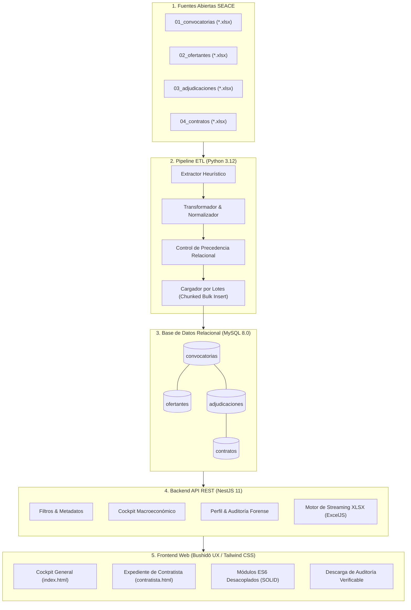

# Monorepo: Sistema Forense y Analítica de Contrataciones Estatales (SEACE / OECE)

Plataforma integral para la extracción masiva, transformación relacional, auditoría forense y visualización ejecutiva de las contrataciones públicas del Estado Peruano (SEACE / OSCE).

El proyecto está organizado como un **monorepositorio** que integra el ciclo completo del dato: desde la ingesta de fuentes públicas abiertas hasta la presentación interactiva y generación de reportes forenses en Excel.

---

## 🏗️ Arquitectura General



---

## 📁 Estructura del Monorepositorio

```
contracts/
├── contracts_etl/                # Pipeline de extracción, limpieza y carga (Python)
│   ├── config/                   # Esquemas y reglas de mapeo de columnas
│   ├── data/                     # Directorios de datos (raw/ y rejected/)
│   ├── docs/                     # Documentación técnica del pipeline y modelo de datos
│   ├── logs/                     # Registro de ejecución y trazabilidad JSON
│   ├── openspec/                 # Especificaciones de ingeniería y tareas
│   ├── sql/ddl/                  # Scripts DDL de inicialización de tablas en MySQL
│   ├── src/                      # Código fuente del pipeline (Database, Loader, Tracker, etc.)
│   ├── tests/                    # Pruebas unitarias e integración con Pytest
│   ├── .env.example              # Plantilla de variables de entorno para el ETL
│   ├── main.py                   # Punto de entrada CLI interactivo
│   ├── requirements.txt          # Dependencias de Python
│   └── README.md                 # Documentación específica del ETL
│
├── frontend/                     # Servidor Fullstack NestJS y Frontend Web
│   ├── context/                  # Historias de usuario, requerimientos y contratos de datos
│   ├── mockups/                  # Mockups de diseño y referencias visuales
│   ├── public/                   # Aplicación Web estática servida por NestJS
│   │   ├── css/                  # Estilos Tailwind CSS compilados
│   │   ├── js/                   # JavaScript modular (ES6 Modules)
│   │   ├── index.html            # Cockpit Principal
│   │   └── contratista.html      # Dossier y Auditoría Forense
│   ├── src/                      # Código fuente Backend NestJS (TypeScript)
│   │   ├── cockpit/              # Módulo de analítica general
│   │   ├── contratistas/         # Módulo de auditoría forense y exportador Excel
│   │   ├── database/             # Módulo de conexión a MySQL
│   │   ├── filtros/              # Módulo de catálogos y selectores
│   │   ├── app.module.ts         # Módulo raíz de NestJS
│   │   └── main.ts               # Punto de entrada de la aplicación
│   ├── .env.example              # Plantilla de variables de entorno para NestJS
│   ├── package.json              # Dependencias y scripts de Node.js
│   └── README.md                 # Documentación específica del Frontend/API
│
├── .env.example                  # Plantilla maestra de variables de entorno
├── .gitignore                    # Reglas globales de exclusión de Git
└── README.md                     # Este documento
```

---

## ⚡ Guía de Inicio Rápido (Quick Start)

### 1. Requisitos Previos

- **MySQL Server 8.0+** instalado y corriendo en `127.0.0.1:3306`.
- **Python 3.10+** (recomendado 3.12).
- **Node.js 18+** (recomendado 20 o 24) y **npm**.

---

### 2. Configurar la Base de Datos MySQL

Cree la base de datos `contrataciones` en su servidor MySQL local:

```sql
CREATE DATABASE IF NOT EXISTS contrataciones
  CHARACTER SET utf8mb4
  COLLATE utf8mb4_unicode_ci;
```

---

### 3. Ejecutar el Pipeline ETL (`contracts_etl`)

1. Navegue al directorio del ETL:
   ```bash
   cd contracts_etl
   ```

2. Cree y active un entorno virtual de Python:
   ```bash
   python -m venv .venv
   # En Windows PowerShell:
   .venv\Scripts\Activate.ps1
   # En Linux / WSL / macOS:
   source .venv/bin/activate
   ```

3. Instale las dependencias:
   ```bash
   pip install -r requirements.txt
   ```

4. Configure sus credenciales copiando `.env.example`:
   ```bash
   cp .env.example .env
   ```

5. Inicialice las tablas relacionales y ejecute el procesamiento:
   ```bash
   # Crear tablas en MySQL:
   python main.py --init-db

   # Procesar los datos (CLI interactivo o automático):
   python main.py --all
   ```

---

### 4. Iniciar la Plataforma Web y API (`frontend`)

1. Navegue al directorio del frontend:
   ```bash
   cd ../frontend
   ```

2. Instale las dependencias de Node:
   ```bash
   npm install
   ```

3. Configure sus credenciales copiando `.env.example`:
   ```bash
   cp .env.example .env
   ```

4. Inicie el servidor de desarrollo NestJS:
   ```bash
   npm run start:dev
   ```

5. Abra su navegador en:
   - **Cockpit Macroeconómico:** [http://localhost:3000/index.html](http://localhost:3000/index.html)
   - **Auditoría de Contratista:** [http://localhost:3000/contratista.html](http://localhost:3000/contratista.html)

---

## 🛡️ Parámetros de Configuración (`.env`)

| Variable | Descripción | Valor por Defecto |
| :--- | :--- | :--- |
| `DB_HOST` | Host del servidor MySQL | `127.0.0.1` |
| `DB_PORT` | Puerto de MySQL | `3306` |
| `DB_USER` | Usuario de MySQL con privilegios de escritura | `etl_user` |
| `DB_PASSWORD` | Contraseña del usuario MySQL | `etl_password` |
| `DB_NAME` | Nombre de la base de datos | `contrataciones` |
| `PORT` | Puerto HTTP para el servidor NestJS | `3000` |
| `NODE_ENV` | Entorno de ejecución (`development` / `production`) | `development` |
| `CHUNK_SIZE` | Tamaño de lote de inserción en el ETL | `3000` |

---

## 📋 Buenas Prácticas de Control de Versiones

- **Archivos Sensibles:** Nunca suba archivos `.env` a Git. Siempre use `.env.example` para documentar las variables necesarias.
- **Datos Pesados:** Las fuentes crudas de SEACE (`.xlsx`) no se incluyen en el repositorio para evitar exceder los límites de Git/GitHub (100 MB). Se proporcionan archivos `.gitkeep` para preservar la estructura de carpetas `data/raw/` requerida por el pipeline.
- **Artefactos Compilados:** Las carpetas `node_modules/`, `dist/`, `.venv/` y cachés `__pycache__` están debidamente ignoradas en `.gitignore`.
