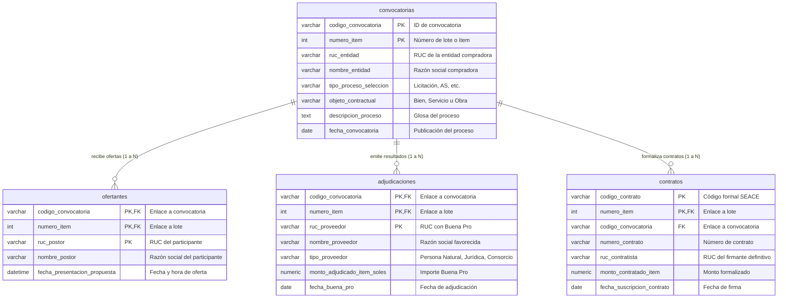

# Especificación Integral de Ingeniería de Datos y Pipeline ETL: Contrataciones Estatales (SEACE / OECE) - Fase 1

Este documento unifica la especificación técnica de la fuente, las problemáticas analíticas de la Fase 1, la arquitectura relacional de cuatro tablas con sus esquemas JSON y scripts DDL, la estructura física del repositorio y la historia de usuario técnica interactiva (US-DATA-001-EXTENDED) con su prompt maestro para Gemini Pro en VS Code.

---

## 1. Identificación de la Fuente y Alcance de la Fase 1

* **Fuente de Datos:** Portal de Datos Abiertos del Organismo Especializado en las Contrataciones Públicas Eficientes y Competitivas (OECE / SEACE)[cite: 1].
* **URL de Acceso:** `https://bi.seace.gob.pe/pentaho/api/repos/%3Apublic%3Aportal%3Adatosabiertos.html/content?userid=public&password=key`[cite: 1].
* **Entorno Tecnológico:** Suite Pentaho Business Intelligence sobre repositorio CONOSCE[cite: 1].
* **Periodicidad de Descarga:** Datasets consolidados anuales en `.xlsx` y `.csv`[cite: 1].
* **Alcance de la Fase 1:** Evaluar la **competencia, concurrencia, postulación y adjudicación** de las contrataciones públicas[cite: 1, 2]. En esta fase se prescinde de importes monetarios y segmentaciones territoriales (reservados para la Fase 2), enfocándose estrictamente en las reglas de participación, filtros técnicos y adjudicación real[cite: 1, 2].

---

## 2. Problemáticas Analíticas de la Fase 1

### Problemática 1: Concurrencia de Postulantes y Determinación del Ganador por Ítem
* **Pregunta Central:** ¿Cuántos proveedores postularon formalmente en cada ítem de una convocatoria y cuál de ellos resultó favorecido con la adjudicación y/o contrato final[cite: 1, 2]?
* **Objetivo:** Mapear la concurrencia real y la trazabilidad de los participantes inscritos por lote frente al ganador[cite: 1, 2].
* **Tablas Involucradas:** `convocatorias`, `ofertantes`, `adjudicaciones`, `contratos`[cite: 1, 2].
* **Regla Analítica:** Conteo agrupado `COUNT(ruc_postor)` en `ofertantes` por `codigo_convocatoria` y `numero_item`, contrastado contra `ruc_proveedor` en `adjudicaciones` y `ruc_contratista` en `contratos`[cite: 1, 2].

### Problemática 2: Adjudicación con Postor Único (Bandera Roja de Concurrencia Nula)
* **Pregunta Central:** ¿En qué procedimientos competitivos ordinarios se presentó un único postor y este obtuvo directamente la adjudicación[cite: 1, 2]?
* **Objetivo:** Detectar riesgos de direccionamiento o falta de concurrencia en procedimientos que por ley exigen pluralidad[cite: 1, 2].
* **Tablas Involucradas:** `convocatorias`, `ofertantes`, `adjudicaciones`[cite: 1, 2].
* **Regla Analítica:** Filtrar convocatorias ordinarias (`tipo_proceso_seleccion NOT LIKE '%DIRECTA%'`)[cite: 1] donde `COUNT(ruc_postor) = 1` en `ofertantes` y dicho postor coincide con `ruc_proveedor` en `adjudicaciones`[cite: 1, 2].

### Problemática 3: Falsa Competencia por Descalificación Masiva
* **Pregunta Central:** ¿En cuántos procedimientos compitieron dos o más postulantes pero todos, salvo el adjudicado, fueron descalificados o no admitidos[cite: 1]?
* **Objetivo:** Revelar concursos con pluralidad formal aparente que operaron en la práctica como contrataciones a postor único debido a barreras técnicas excluyentes[cite: 1].
* **Tablas Involucradas:** `ofertantes`, `adjudicaciones`[cite: 1].
* **Regla Analítica:** Identificar lotes con `COUNT(ruc_postor) >= 2` donde solo una propuesta sobrevivió a la calificación previa al otorgamiento de la Buena Pro[cite: 1].

### Problemática 4: Detección de Postores Recurrentes sin Éxito ("Postores de Relleno")
* **Pregunta Central:** ¿Qué empresas presentan un volumen alto de postulaciones a lo largo del tiempo pero registran cero contratos obtenidos o son sistemáticamente apartadas[cite: 1]?
* **Objetivo:** Identificar postores instrumentales que validan el quórum mínimo de competencia formal sin una intención competitiva real[cite: 1].
* **Tablas Involucradas:** `ofertantes`, `adjudicaciones`, `contratos`[cite: 1].
* **Regla Analítica:** Proveedores con alto recuento acumulado en `ofertantes` que mediante `LEFT JOIN` presentan valor nulo en `adjudicaciones` y `contratos`[cite: 1, 2].

### Problemática 5: Efectividad Competitiva según Tipo de Postor (Consorcios vs. Individuales)
* **Pregunta Central:** ¿Presentan los consorcios una mayor tasa de adjudicación frente a las empresas que compiten de manera individual[cite: 1, 2]?
* **Objetivo:** Medir si la asociación empresarial representa una ventaja desproporcionada en la adjudicación de contratos públicos[cite: 1].
* **Tablas Involucradas:** `ofertantes`, `adjudicaciones`[cite: 1].
* **Regla Analítica:** Agrupación por `tipo_proveedor` (`Consorcio` vs. individual) y cálculo de la tasa de éxito: adjudicaciones ganadas sobre total de ofertas presentadas[cite: 1, 2].

---

## 3. Justificación Arquitectónica del Modelo de 4 Tablas

Originalmente se contemplaba una estructura de tres tablas (`convocatorias`, `ofertantes` y `adjudicaciones`)[cite: 1]. Sin embargo, bajo la Ley de Contrataciones del Estado (Ley 30225) y la dinámica operativa del SEACE, se identificaron dos definiciones críticas:

### A. Necesidad de incorporar `contratos` (Módulo 10)
1. **Adjudicación (Buena Pro) no equivale a Ejecución:** En la tabla `adjudicaciones` se registra el ganador del concurso[cite: 1]. No obstante, si el adjudicado no entrega las cartas fianza de fiel cumplimiento, pierde su vigencia de poder o desiste, la entidad le retira la Buena Pro y convoca al **segundo postor en orden de prelación** o declara desierto el lote.
2. **Determinación del Ganador Real:** La única tabla que certifica jurídicamente qué empresa ejecutó la prestación pública y cobró por ella es `contratos`[cite: 1].
3. **Control de Brechas:** Permite auditar el indicador: *Buena Pro otorgada que nunca derivó en contrato firmado*.

### B. Descarte de `CONTRATACIONES DIRECTAS` como tabla independiente
1. **Riesgo Metodológico de Falso Positivo:** Las contrataciones directas son compras por excepción (emergencias sanitarias, desabastecimiento inminente, monopolios técnicos) que por mandato legal prescinden de concurso público y concurrencia[cite: 1].
2. **Distorsión del Análisis:** Incluir esa tabla en la Fase 1 catalogaría artificialmente miles de compras legítimas sin concurso como "anomalías colusorias de postor único".
3. **Cobertura Existente:** Dichos procedimientos ya figuran identificados dentro del campo `tipo_proceso_seleccion` de las tablas maestras[cite: 1]. Se gestionan simplemente mediante filtros `WHERE` sin requerir esquemas adicionales[cite: 1].

---

## 4. Diagrama Entidad-Relación (Mermaid ERD)



---

## 5. Diccionarios de Datos y Mapeos de Columnas (Excel a SQL)

### 5.1. Tabla: `convocatorias`
* **Llave Primaria (PK):** `(codigo_convocatoria, numero_item)`[cite: 9, 10].
* **Columnas Origen Excel:** 27 columnas[cite: 10].

| N° | Columna Excel (Origen) | Columna SQL (`snake_case`) | Tipo SQL | Tipo Python | Nulable | Descripción / Rol |
| :---: | :--- | :--- | :--- | :--- | :---: | :--- |
| 1 | `entidad_ruc` | `ruc_entidad` | `VARCHAR(11)`[cite: 9, 10] | `str`[cite: 10] | No[cite: 9, 10] | RUC de la entidad compradora[cite: 9, 10] |
| 2 | `entidad` | `nombre_entidad` | `VARCHAR(255)`[cite: 9, 10] | `str`[cite: 10] | Sí[cite: 10] | Nombre o razón social de la entidad pública[cite: 9, 10] |
| 3 | `tipoentidad` | `tipo_entidad` | `VARCHAR(100)`[cite: 9, 10] | `str`[cite: 10] | Sí[cite: 10] | Tipo institucional de la entidad[cite: 9, 10] |
| 4 | `codigoconvocatoria` | `codigo_convocatoria` | `VARCHAR(20)`[cite: 9, 10] | `str`[cite: 10] | **PK (1/2)**[cite: 9, 10] | Identificador único del expediente SEACE[cite: 9, 10] |
| 5 | `descripcion_proceso` | `descripcion_proceso` | `TEXT`[cite: 9, 10] | `str`[cite: 10] | Sí[cite: 10] | Glosa general de la licitación[cite: 9, 10] |
| 6 | `proceso` | `nomenclatura_proceso` | `VARCHAR(100)`[cite: 9, 10] | `str`[cite: 10] | Sí[cite: 10] | Nomenclatura oficial (ej. AS-SM-1-2018)[cite: 9, 10] |
| 7 | `tipocompra` | `tipo_compra` | `VARCHAR(100)`[cite: 9, 10] | `str`[cite: 10] | Sí[cite: 10] | Régimen o tipología de la compra[cite: 9, 10] |
| 8 | `objetocontractual` | `objeto_contractual` | `VARCHAR(50)`[cite: 9, 10] | `str`[cite: 10] | Sí[cite: 10] | Bien, Servicio, Obra o Consultoría[cite: 9, 10] |
| 9 | `SECTOR / NIVEL DE GOBIERNO` | `sector_nivel_gobierno` | `VARCHAR(100)`[cite: 9, 10] | `str`[cite: 10] | Sí[cite: 10] | Clasificación territorial/sectorial de gobierno[cite: 9, 10] |
| 10 | `sistema_contratacion` | `sistema_contratacion` | `VARCHAR(100)`[cite: 9, 10] | `str`[cite: 10] | Sí[cite: 10] | Suma alzada, precios unitarios, esquema mixto[cite: 9, 10] |
| 11 | `tipoprocesoseleccion` | `tipo_proceso_seleccion` | `VARCHAR(100)`[cite: 9, 10] | `str`[cite: 10] | Sí[cite: 10] | Licitación, Concurso, Adjudicación Simplificada[cite: 9, 10] |
| 12 | `montoreferencial` | `monto_referencial_proceso` | `DECIMAL(16,2)`[cite: 9, 10] | `float`[cite: 10] | Sí[cite: 10] | Presupuesto referencial consolidado del proceso[cite: 9, 10] |
| 13 | `n_item` | `numero_item` | `INT`[cite: 9, 10] | `int`[cite: 10] | **PK (2/2)**[cite: 9, 10] | Número ordinal del ítem o lote convocado[cite: 9, 10] |
| 14 | `descripcion_item` | `descripcion_item` | `TEXT`[cite: 9, 10] | `str`[cite: 10] | Sí[cite: 10] | Especificación técnica del lote/ítem[cite: 9, 10] |
| 15 | `unidad_medida` | `unidad_medida` | `VARCHAR(50)`[cite: 9, 10] | `str`[cite: 10] | Sí[cite: 10] | Unidad física de despacho o prestación[cite: 9, 10] |
| 16 | `estadoitem` | `estado_item` | `VARCHAR(50)`[cite: 9, 10] | `str`[cite: 10] | Sí[cite: 10] | Condición administrativa del ítem[cite: 9, 10] |
| 17 | `paquete` | `es_paquete` | `VARCHAR(20)`[cite: 9, 10] | `str`[cite: 10] | Sí[cite: 10] | Indicador de convocatoria por paquete[cite: 9, 10] |
| 18 | `codigoitem` | `codigo_item` | `VARCHAR(50)`[cite: 9, 10] | `str`[cite: 10] | Sí[cite: 10] | Identificador de ítem en plataforma[cite: 9, 10] |
| 19 | `itemcubso` | `item_cubso` | `VARCHAR(50)`[cite: 9, 10] | `str`[cite: 10] | Sí[cite: 10] | Código de catálogo estandarizado CUBSO[cite: 9, 10] |
| 20 | `monto_referencial_item` | `monto_referencial_item` | `DECIMAL(16,2)`[cite: 9, 10] | `float`[cite: 10] | Sí[cite: 10] | Presupuesto base del ítem/lote individual[cite: 9, 10] |
| 21 | `moneda` | `moneda` | `VARCHAR(10)`[cite: 9, 10] | `str`[cite: 10] | Sí[cite: 10] | Denominación monetaria (SOLES, DOLARES)[cite: 9, 10] |
| 22 | `departamento_item` | `departamento_item` | `VARCHAR(100)`[cite: 9, 10] | `str`[cite: 10] | Sí[cite: 10] | Departamento territorial del ítem[cite: 9, 10] |
| 23 | `provincia_item` | `provincia_item` | `VARCHAR(100)`[cite: 9, 10] | `str`[cite: 10] | Sí[cite: 10] | Provincia territorial del ítem[cite: 9, 10] |
| 24 | `distrito_item` | `distrito_item` | `VARCHAR(100)`[cite: 9, 10] | `str`[cite: 10] | Sí[cite: 10] | Distrito territorial del ítem[cite: 9, 10] |
| 25 | `fecha_convocatoria` | `fecha_convocatoria` | `DATE`[cite: 9, 10] | `date`[cite: 10] | Sí[cite: 10] | Fecha de publicación de la licitación[cite: 9, 10] |
| 26 | `fechaintegracionbases` | `fecha_integracion_bases` | `DATE`[cite: 9, 10] | `date`[cite: 10] | Sí[cite: 10] | Fecha de cierre de observaciones a bases[cite: 9, 10] |
| 27 | `fechapresentacionpropuesta` | `fecha_presentacion_propuesta` | `DATETIME`[cite: 9, 10] | `datetime`[cite: 10] | Sí[cite: 10] | Límite formal de ingreso de ofertas[cite: 9, 10] |

---

### 5.2. Tabla: `ofertantes`
* **Llave Primaria (PK):** Compuesta `(codigo_convocatoria, numero_item, ruc_postor)`[cite: 7, 8].
* **Llave Foránea (FK):** `(codigo_convocatoria, numero_item)` referencia a `convocatorias`[cite: 7, 8].
* **Columnas Origen Excel:** 6 columnas[cite: 8].

| N° | Columna Excel (Origen) | Columna SQL (`snake_case`) | Tipo SQL | Tipo Python | Nulable | Descripción / Rol |
| :---: | :--- | :--- | :--- | :--- | :---: | :--- |
| 1 | `codigo_convocatoria` | `codigo_convocatoria` | `VARCHAR(20)`[cite: 7, 8] | `str`[cite: 8] | **PK (1/3), FK (1/2)**[cite: 7, 8] | Enlace con la convocatoria[cite: 7, 8] |
| 2 | `fechaconvocatoria` | `fecha_convocatoria` | `DATE`[cite: 7, 8] | `date`[cite: 8] | Sí[cite: 8] | Fecha registrada de la convocatoria[cite: 7, 8] |
| 3 | `n_item` | `numero_item` | `INT`[cite: 7, 8] | `int`[cite: 8] | **PK (2/3), FK (2/2)**[cite: 7, 8] | Enlace con el ítem licitado[cite: 7, 8] |
| 4 | `ruc_codigo_postor` | `ruc_postor` | `VARCHAR(20)`[cite: 7, 8] | `str`[cite: 8] | **PK (3/3)**[cite: 7, 8] | RUC del proveedor o consorcio[cite: 7, 8] |
| 5 | `postor` | `nombre_postor` | `VARCHAR(255)`[cite: 7, 8] | `str`[cite: 8] | Sí[cite: 8] | Razón social del competidor[cite: 7, 8] |
| 6 | `fecha_presentacion_propuesta` | `fecha_presentacion_propuesta` | `DATETIME`[cite: 7, 8] | `datetime`[cite: 8] | Sí[cite: 8] | Timestamp de registro de la oferta[cite: 7, 8] |

---

### 5.3. Tabla: `adjudicaciones`
* **Llave Primaria (PK):** Compuesta `(codigo_convocatoria, numero_item, ruc_proveedor)`[cite: 5, 6].
* **Llave Foránea (FK):** `(codigo_convocatoria, numero_item)` referencia a `convocatorias`[cite: 5, 6].
* **Columnas Origen Excel:** 25 columnas[cite: 6].

| N° | Columna Excel (Origen) | Columna SQL (`snake_case`) | Tipo SQL | Tipo Python | Nulable | Descripción / Rol |
| :---: | :--- | :--- | :--- | :--- | :---: | :--- |
| 1 | `codigoentidad` | `codigo_entidad` | `VARCHAR(20)`[cite: 5, 6] | `str`[cite: 6] | Sí[cite: 6] | Código interno de la entidad en SEACE[cite: 5, 6] |
| 2 | `entidad_ruc` | `ruc_entidad` | `VARCHAR(11)`[cite: 5, 6] | `str`[cite: 6] | No[cite: 5, 6] | RUC de la entidad compradora[cite: 5, 6] |
| 3 | `entidad` | `nombre_entidad` | `VARCHAR(255)`[cite: 5, 6] | `str`[cite: 6] | Sí[cite: 6] | Nombre oficial de la entidad contratante[cite: 5, 6] |
| 4 | `tipoentidad` | `tipo_entidad` | `VARCHAR(100)`[cite: 5, 6] | `str`[cite: 6] | Sí[cite: 6] | Clasificación institucional[cite: 5, 6] |
| 5 | `entidad_departamento` | `entidad_departamento` | `VARCHAR(100)`[cite: 5, 6] | `str`[cite: 6] | Sí[cite: 6] | Departamento geográfico de la sede pública[cite: 5, 6] |
| 6 | `codigoconvocatoria` | `codigo_convocatoria` | `VARCHAR(20)`[cite: 5, 6] | `str`[cite: 6] | **PK (1/3), FK (1/2)**[cite: 5, 6] | Enlace a la convocatoria[cite: 5, 6] |
| 7 | `objetocontractual` | `objeto_contractual` | `VARCHAR(50)`[cite: 5, 6] | `str`[cite: 6] | Sí[cite: 6] | Bien, Servicio, Obra o Consultoría[cite: 5, 6] |
| 8 | `tipoprocesoseleccion` | `tipo_proceso_seleccion` | `VARCHAR(100)`[cite: 5, 6] | `str`[cite: 6] | Sí[cite: 6] | Tipología del proceso de selección[cite: 5, 6] |
| 9 | `proceso` | `nomenclatura_proceso` | `VARCHAR(100)`[cite: 5, 6] | `str`[cite: 6] | Sí[cite: 6] | Código de proceso formal[cite: 5, 6] |
| 10 | `descripcion_proceso` | `descripcion_proceso` | `TEXT`[cite: 5, 6] | `str`[cite: 6] | Sí[cite: 6] | Glosa descriptiva del expediente[cite: 5, 6] |
| 11 | `n_item` | `numero_item` | `INT`[cite: 5, 6] | `int`[cite: 6] | **PK (2/3), FK (2/2)**[cite: 5, 6] | Enlace al lote o ítem[cite: 5, 6] |
| 12 | `descripcion_item` | `descripcion_item` | `TEXT`[cite: 5, 6] | `str`[cite: 6] | Sí[cite: 6] | Detalle técnico del lote adjudicado[cite: 5, 6] |
| 13 | `estado_item` | `estado_item` | `VARCHAR(50)`[cite: 5, 6] | `str`[cite: 6] | Sí[cite: 6] | Estado formal (Adjudicado, Consentido)[cite: 5, 6] |
| 14 | `cantidad_adjudicado_item` | `cantidad_adjudicado_item` | `DECIMAL(12,2)`[cite: 5, 6] | `float`[cite: 6] | Sí[cite: 6] | Cantidad física otorgada del bien/servicio[cite: 5, 6] |
| 15 | `monto_referencial_item_soles` | `monto_referencial_item_soles` | `DECIMAL(16,2)`[cite: 5, 6] | `float`[cite: 6] | Sí[cite: 6] | Presupuesto referencial del ítem en Soles[cite: 5, 6] |
| 16 | `monto_adjudicado_item_soles` | `monto_adjudicado_item_soles` | `DECIMAL(16,2)`[cite: 5, 6] | `float`[cite: 6] | Sí[cite: 6] | Importe adjudicado de la Buena Pro en PEN[cite: 5, 6] |
| 17 | `departamento_item` | `departamento_item` | `VARCHAR(100)`[cite: 5, 6] | `str`[cite: 6] | Sí[cite: 6] | Ubicación territorial de ejecución del lote[cite: 5, 6] |
| 18 | `moneda` | `moneda` | `VARCHAR(10)`[cite: 5, 6] | `str`[cite: 6] | Sí[cite: 6] | Denominación monetaria de adjudicación[cite: 5, 6] |
| 19 | `unidad_medida` | `unidad_medida` | `VARCHAR(50)`[cite: 5, 6] | `str`[cite: 6] | Sí[cite: 6] | Presentación física contratada[cite: 5, 6] |
| 20 | `ruc_proveedor` | `ruc_proveedor` | `VARCHAR(20)`[cite: 5, 6] | `str`[cite: 6] | **PK (3/3)**[cite: 5, 6] | RUC del adjudicado con la Buena Pro[cite: 5, 6] |
| 21 | `proveedor` | `nombre_proveedor` | `VARCHAR(255)`[cite: 5, 6] | `str`[cite: 6] | Sí[cite: 6] | Razón social del adjudicado[cite: 5, 6] |
| 22 | `tipo_proveedor` | `tipo_proveedor` | `VARCHAR(50)`[cite: 5, 6] | `str`[cite: 6] | Sí[cite: 6] | Persona Natural, Jurídica o Consorcio[cite: 5, 6] |
| 23 | `fecha_convocatoria` | `fecha_convocatoria` | `DATE`[cite: 5, 6] | `date`[cite: 6] | Sí[cite: 6] | Fecha registrada de la convocatoria[cite: 5, 6] |
| 24 | `fecha_buenapro` | `fecha_buena_pro` | `DATE`[cite: 5, 6] | `date`[cite: 6] | Sí[cite: 6] | Fecha oficial del acto de Buena Pro[cite: 5, 6] |
| 25 | `fecha_consentimiento_bp` | `fecha_consentimiento_bp` | `DATE`[cite: 5, 6] | `date`[cite: 6] | Sí[cite: 6] | Fecha en que queda firme administrativamente[cite: 5, 6] |

---

### 5.4. Tabla: `contratos`
* **Llave Primaria (PK):** Compuesta `(codigo_contrato, numero_item)`[cite: 3, 4].
* **Llave Foránea (FK):** `(codigo_convocatoria, numero_item)` referencia a `convocatorias`[cite: 3, 4].
* **Columnas Origen Excel:** 24 columnas[cite: 4].

| N° | Columna Excel (Origen) | Columna SQL (`snake_case`) | Tipo SQL | Tipo Python | Nulable | Descripción / Rol |
| :---: | :--- | :--- | :--- | :--- | :---: | :--- |
| 1 | `codigoentidad` | `codigo_entidad` | `VARCHAR(20)`[cite: 3, 4] | `str`[cite: 4] | Sí[cite: 4] | Código SEACE de la institución pública[cite: 3, 4] |
| 2 | `codigoconvocatoria` | `codigo_convocatoria` | `VARCHAR(20)`[cite: 3, 4] | `str`[cite: 4] | **FK (1/2)**[cite: 3, 4] | Enlace relacional a la convocatoria[cite: 3, 4] |
| 3 | `descripcion_proceso` | `descripcion_proceso` | `TEXT`[cite: 3, 4] | `str`[cite: 4] | Sí[cite: 4] | Glosa general del expediente licitado[cite: 3, 4] |
| 4 | `n_cod_contrato` | `id_contrato_sistema` | `BIGINT`[cite: 3, 4] | `int`[cite: 4] | No[cite: 3, 4] | Identificador numérico interno del contrato[cite: 3, 4] |
| 5 | `codigo_contrato` | `codigo_contrato` | `VARCHAR(50)`[cite: 3, 4] | `str`[cite: 4] | **PK (1/2)**[cite: 3, 4] | Código oficial del contrato en SEACE[cite: 3, 4] |
| 6 | `num_contrato` | `numero_contrato` | `VARCHAR(100)`[cite: 3, 4] | `str`[cite: 4] | Sí[cite: 4] | Número formal del contrato físico[cite: 3, 4] |
| 7 | `numero_item` | `numero_item` | `INT`[cite: 3, 4] | `int`[cite: 4] | **PK (2/2), FK (2/2)**[cite: 3, 4] | Enlace al lote o ítem contratado[cite: 3, 4] |
| 8 | `monto_contratado_total` | `monto_contratado_total` | `DECIMAL(16,2)`[cite: 3, 4] | `float`[cite: 4] | Sí[cite: 4] | Monto global suscrito en el contrato[cite: 3, 4] |
| 9 | `monto_contratado_item` | `monto_contratado_item` | `DECIMAL(16,2)`[cite: 3, 4] | `float`[cite: 4] | Sí[cite: 4] | Monto suscrito aplicable al ítem[cite: 3, 4] |
| 10 | `monto_adicional` | `monto_adicional` | `DECIMAL(16,2)`[cite: 3, 4] | `float`[cite: 4] | Sí[cite: 4] | Monto de presupuestos adicionales aprobados[cite: 3, 4] |
| 11 | `monto_reduccion` | `monto_reduccion` | `DECIMAL(16,2)`[cite: 3, 4] | `float`[cite: 4] | Sí[cite: 4] | Deducciones o reducciones de contrato[cite: 3, 4] |
| 12 | `monto_prorroga` | `monto_prorroga` | `DECIMAL(16,2)`[cite: 3, 4] | `float`[cite: 4] | Sí[cite: 4] | Importe económico de prórrogas aprobadas[cite: 3, 4] |
| 13 | `monto_complementario` | `monto_complementario` | `DECIMAL(16,2)`[cite: 3, 4] | `float`[cite: 4] | Sí[cite: 4] | Importe de contratos complementarios[cite: 3, 4] |
| 14 | `moneda` | `moneda` | `VARCHAR(10)`[cite: 3, 4] | `str`[cite: 4] | Sí[cite: 4] | Moneda contractual formalizada[cite: 3, 4] |
| 15 | `ruc_contratista` | `ruc_contratista` | `VARCHAR(20)`[cite: 3, 4] | `str`[cite: 4] | No[cite: 3, 4] | RUC del contratista que firmó efectivamente[cite: 3, 4] |
| 16 | `ruc_destinatario_pago` | `ruc_destinatario_pago` | `VARCHAR(20)`[cite: 3, 4] | `str`[cite: 4] | Sí[cite: 4] | RUC receptor de pago (factoring o líder)[cite: 3, 4] |
| 17 | `tieneresolucion` | `tiene_resolucion` | `VARCHAR(10)`[cite: 3, 4] | `str`[cite: 4] | Sí[cite: 4] | Indica si el contrato fue resuelto (SI/NO)[cite: 3, 4] |
| 18 | `urlcontrato` | `url_contrato` | `TEXT`[cite: 3, 4] | `str`[cite: 4] | Sí[cite: 4] | Enlace web al contrato digitalizado[cite: 3, 4] |
| 19 | `espublicado` | `es_publicado` | `VARCHAR(10)`[cite: 3, 4] | `str`[cite: 4] | Sí[cite: 4] | Estado público en el repositorio oficial[cite: 3, 4] |
| 20 | `fecha_publicacion_contrato` | `fecha_publicacion_contrato` | `DATE`[cite: 3, 4] | `date`[cite: 4] | Sí[cite: 4] | Fecha de publicación del documento en SEACE[cite: 3, 4] |
| 21 | `fecha_suscripcion_contrato` | `fecha_suscripcion_contrato` | `DATE`[cite: 3, 4] | `date`[cite: 4] | Sí[cite: 4] | Fecha de firma jurídica del contrato[cite: 3, 4] |
| 22 | `fecha_vigencia_inicial` | `fecha_vigencia_inicial` | `DATE`[cite: 3, 4] | `date`[cite: 4] | Sí[cite: 4] | Fecha oficial de inicio de ejecución[cite: 3, 4] |
| 23 | `fecha_vigencia_final` | `fecha_vigencia_final` | `DATE`[cite: 3, 4] | `date`[cite: 4] | Sí[cite: 4] | Fecha oficial estipulada de fin de ejecución[cite: 3, 4] |
| 24 | `fecha_vigencia_fin_actualizada`| `fecha_vigencia_fin_actualizada`| `DATE`[cite: 3, 4] | `date`[cite: 4] | Sí[cite: 4] | Fecha de fin con ampliaciones de plazo[cite: 3, 4] |

---

## 6. Archivos de Esquema Declarativo JSON (`config/schemas/`)

### `config/schemas/schema_convocatorias.json`
```json
{
  "table_name": "convocatorias",
  "primary_key": ["codigo_convocatoria", "numero_item"],
  "foreign_keys": [],
  "columns": [
    {"excel_column": "entidad_ruc", "sql_column": "ruc_entidad", "sql_type": "VARCHAR(11)", "python_type": "str", "nullable": false},
    {"excel_column": "entidad", "sql_column": "nombre_entidad", "sql_type": "VARCHAR(255)", "python_type": "str", "nullable": true},
    {"excel_column": "tipoentidad", "sql_column": "tipo_entidad", "sql_type": "VARCHAR(100)", "python_type": "str", "nullable": true},
    {"excel_column": "codigoconvocatoria", "sql_column": "codigo_convocatoria", "sql_type": "VARCHAR(20)", "python_type": "str", "nullable": false},
    {"excel_column": "descripcion_proceso", "sql_column": "descripcion_proceso", "sql_type": "TEXT", "python_type": "str", "nullable": true},
    {"excel_column": "proceso", "sql_column": "nomenclatura_proceso", "sql_type": "VARCHAR(100)", "python_type": "str", "nullable": true},
    {"excel_column": "tipocompra", "sql_column": "tipo_compra", "sql_type": "VARCHAR(100)", "python_type": "str", "nullable": true},
    {"excel_column": "objetocontractual", "sql_column": "objeto_contractual", "sql_type": "VARCHAR(50)", "python_type": "str", "nullable": true},
    {"excel_column": "SECTOR / NIVEL DE GOBIERNO", "sql_column": "sector_nivel_gobierno", "sql_type": "VARCHAR(100)", "python_type": "str", "nullable": true},
    {"excel_column": "sistema_contratacion", "sql_column": "sistema_contratacion", "sql_type": "VARCHAR(100)", "python_type": "str", "nullable": true},
    {"excel_column": "tipoprocesoseleccion", "sql_column": "tipo_proceso_seleccion", "sql_type": "VARCHAR(100)", "python_type": "str", "nullable": true},
    {"excel_column": "montoreferencial", "sql_column": "monto_referencial_proceso", "sql_type": "DECIMAL(16,2)", "python_type": "float", "nullable": true},
    {"excel_column": "n_item", "sql_column": "numero_item", "sql_type": "INT", "python_type": "int", "nullable": false},
    {"excel_column": "descripcion_item", "sql_column": "descripcion_item", "sql_type": "TEXT", "python_type": "str", "nullable": true},
    {"excel_column": "unidad_medida", "sql_column": "unidad_medida", "sql_type": "VARCHAR(50)", "python_type": "str", "nullable": true},
    {"excel_column": "estadoitem", "sql_column": "estado_item", "sql_type": "VARCHAR(50)", "python_type": "str", "nullable": true},
    {"excel_column": "paquete", "sql_column": "es_paquete", "sql_type": "VARCHAR(20)", "python_type": "str", "nullable": true},
    {"excel_column": "codigoitem", "sql_column": "codigo_item", "sql_type": "VARCHAR(50)", "python_type": "str", "nullable": true},
    {"excel_column": "itemcubso", "sql_column": "item_cubso", "sql_type": "VARCHAR(50)", "python_type": "str", "nullable": true},
    {"excel_column": "monto_referencial_item", "sql_column": "monto_referencial_item", "sql_type": "DECIMAL(16,2)", "python_type": "float", "nullable": true},
    {"excel_column": "moneda", "sql_column": "moneda", "sql_type": "VARCHAR(10)", "python_type": "str", "nullable": true},
    {"excel_column": "departamento_item", "sql_column": "departamento_item", "sql_type": "VARCHAR(100)", "python_type": "str", "nullable": true},
    {"excel_column": "provincia_item", "sql_column": "provincia_item", "sql_type": "VARCHAR(100)", "python_type": "str", "nullable": true},
    {"excel_column": "distrito_item", "sql_column": "distrito_item", "sql_type": "VARCHAR(100)", "python_type": "str", "nullable": true},
    {"excel_column": "fecha_convocatoria", "sql_column": "fecha_convocatoria", "sql_type": "DATE", "python_type": "date", "nullable": true},
    {"excel_column": "fechaintegracionbases", "sql_column": "fecha_integracion_bases", "sql_type": "DATE", "python_type": "date", "nullable": true},
    {"excel_column": "fechapresentacionpropuesta", "sql_column": "fecha_presentacion_propuesta", "sql_type": "DATETIME", "python_type": "datetime", "nullable": true}
  ]
}
```[cite: 10]

### `config/schemas/schema_ofertantes.json`
```json
{
  "table_name": "ofertantes",
  "primary_key": ["codigo_convocatoria", "numero_item", "ruc_postor"],
  "foreign_keys": [
    {
      "columns": ["codigo_convocatoria", "numero_item"],
      "reference_table": "convocatorias",
      "reference_columns": ["codigo_convocatoria", "numero_item"]
    }
  ],
  "columns": [
    {
      "excel_column": "codigo_convocatoria",
      "sql_column": "codigo_convocatoria",
      "sql_type": "VARCHAR(20)",
      "python_type": "str",
      "nullable": false
    },
    {
      "excel_column": "fechaconvocatoria",
      "sql_column": "fecha_convocatoria",
      "sql_type": "DATE",
      "python_type": "date",
      "nullable": true
    },
    {
      "excel_column": "n_item",
      "sql_column": "numero_item",
      "sql_type": "INT",
      "python_type": "int",
      "nullable": false
    },
    {
      "excel_column": "ruc_codigo_postor",
      "sql_column": "ruc_postor",
      "sql_type": "VARCHAR(20)",
      "python_type": "str",
      "nullable": false
    },
    {
      "excel_column": "postor",
      "sql_column": "nombre_postor",
      "sql_type": "VARCHAR(255)",
      "python_type": "str",
      "nullable": true
    },
    {
      "excel_column": "fecha_presentacion_propuesta",
      "sql_column": "fecha_presentacion_propuesta",
      "sql_type": "DATETIME",
      "python_type": "datetime",
      "nullable": true
    }
  ]
}
```[cite: 8]

### `config/schemas/schema_adjudicaciones.json`
```json
{
  "table_name": "adjudicaciones",
  "primary_key": ["codigo_convocatoria", "numero_item", "ruc_proveedor"],
  "foreign_keys": [
    {
      "columns": ["codigo_convocatoria", "numero_item"],
      "reference_table": "convocatorias",
      "reference_columns": ["codigo_convocatoria", "numero_item"]
    }
  ],
  "columns": [
    {"excel_column": "codigoentidad", "sql_column": "codigo_entidad", "sql_type": "VARCHAR(20)", "python_type": "str", "nullable": true},
    {"excel_column": "entidad_ruc", "sql_column": "ruc_entidad", "sql_type": "VARCHAR(11)", "python_type": "str", "nullable": false},
    {"excel_column": "entidad", "sql_column": "nombre_entidad", "sql_type": "VARCHAR(255)", "python_type": "str", "nullable": true},
    {"excel_column": "tipoentidad", "sql_column": "tipo_entidad", "sql_type": "VARCHAR(100)", "python_type": "str", "nullable": true},
    {"excel_column": "entidad_departamento", "sql_column": "entidad_departamento", "sql_type": "VARCHAR(100)", "python_type": "str", "nullable": true},
    {"excel_column": "codigoconvocatoria", "sql_column": "codigo_convocatoria", "sql_type": "VARCHAR(20)", "python_type": "str", "nullable": false},
    {"excel_column": "objetocontractual", "sql_column": "objeto_contractual", "sql_type": "VARCHAR(50)", "python_type": "str", "nullable": true},
    {"excel_column": "tipoprocesoseleccion", "sql_column": "tipo_proceso_seleccion", "sql_type": "VARCHAR(100)", "python_type": "str", "nullable": true},
    {"excel_column": "proceso", "sql_column": "nomenclatura_proceso", "sql_type": "VARCHAR(100)", "python_type": "str", "nullable": true},
    {"excel_column": "descripcion_proceso", "sql_column": "descripcion_proceso", "sql_type": "TEXT", "python_type": "str", "nullable": true},
    {"excel_column": "n_item", "sql_column": "numero_item", "sql_type": "INT", "python_type": "int", "nullable": false},
    {"excel_column": "descripcion_item", "sql_column": "descripcion_item", "sql_type": "TEXT", "python_type": "str", "nullable": true},
    {"excel_column": "estado_item", "sql_column": "estado_item", "sql_type": "VARCHAR(50)", "python_type": "str", "nullable": true},
    {"excel_column": "cantidad_adjudicado_item", "sql_column": "cantidad_adjudicado_item", "sql_type": "DECIMAL(12,2)", "python_type": "float", "nullable": true},
    {"excel_column": "monto_referencial_item_soles", "sql_column": "monto_referencial_item_soles", "sql_type": "DECIMAL(16,2)", "python_type": "float", "nullable": true},
    {"excel_column": "monto_adjudicado_item_soles", "sql_column": "monto_adjudicado_item_soles", "sql_type": "DECIMAL(16,2)", "python_type": "float", "nullable": true},
    {"excel_column": "departamento_item", "sql_column": "departamento_item", "sql_type": "VARCHAR(100)", "python_type": "str", "nullable": true},
    {"excel_column": "moneda", "sql_column": "moneda", "sql_type": "VARCHAR(10)", "python_type": "str", "nullable": true},
    {"excel_column": "unidad_medida", "sql_column": "unidad_medida", "sql_type": "VARCHAR(50)", "python_type": "str", "nullable": true},
    {"excel_column": "ruc_proveedor", "sql_column": "ruc_proveedor", "sql_type": "VARCHAR(20)", "python_type": "str", "nullable": false},
    {"excel_column": "proveedor", "sql_column": "nombre_proveedor", "sql_type": "VARCHAR(255)", "python_type": "str", "nullable": true},
    {"excel_column": "tipo_proveedor", "sql_column": "tipo_proveedor", "sql_type": "VARCHAR(50)", "python_type": "str", "nullable": true},
    {"excel_column": "fecha_convocatoria", "sql_column": "fecha_convocatoria", "sql_type": "DATE", "python_type": "date", "nullable": true},
    {"excel_column": "fecha_buenapro", "sql_column": "fecha_buena_pro", "sql_type": "DATE", "python_type": "date", "nullable": true},
    {"excel_column": "fecha_consentimiento_bp", "sql_column": "fecha_consentimiento_bp", "sql_type": "DATE", "python_type": "date", "nullable": true}
  ]
}
```[cite: 6]

### `config/schemas/schema_contratos.json`
```json
{
  "table_name": "contratos",
  "primary_key": ["codigo_contrato", "numero_item"],
  "foreign_keys": [
    {
      "columns": ["codigo_convocatoria", "numero_item"],
      "reference_table": "convocatorias",
      "reference_columns": ["codigo_convocatoria", "numero_item"]
    }
  ],
  "columns": [
    {"excel_column": "codigoentidad", "sql_column": "codigo_entidad", "sql_type": "VARCHAR(20)", "python_type": "str", "nullable": true},
    {"excel_column": "codigoconvocatoria", "sql_column": "codigo_convocatoria", "sql_type": "VARCHAR(20)", "python_type": "str", "nullable": false},
    {"excel_column": "descripcion_proceso", "sql_column": "descripcion_proceso", "sql_type": "TEXT", "python_type": "str", "nullable": true},
    {"excel_column": "n_cod_contrato", "sql_column": "id_contrato_sistema", "sql_type": "BIGINT", "python_type": "int", "nullable": false},
    {"excel_column": "codigo_contrato", "sql_column": "codigo_contrato", "sql_type": "VARCHAR(50)", "python_type": "str", "nullable": false},
    {"excel_column": "num_contrato", "sql_column": "numero_contrato", "sql_type": "VARCHAR(100)", "python_type": "str", "nullable": true},
    {"excel_column": "numero_item", "sql_column": "numero_item", "sql_type": "INT", "python_type": "int", "nullable": false},
    {"excel_column": "monto_contratado_total", "sql_column": "monto_contratado_total", "sql_type": "DECIMAL(16,2)", "python_type": "float", "nullable": true},
    {"excel_column": "monto_contratado_item", "sql_column": "monto_contratado_item", "sql_type": "DECIMAL(16,2)", "python_type": "float", "nullable": true},
    {"excel_column": "monto_adicional", "sql_column": "monto_adicional", "sql_type": "DECIMAL(16,2)", "python_type": "float", "nullable": true},
    {"excel_column": "monto_reduccion", "sql_column": "monto_reduccion", "sql_type": "DECIMAL(16,2)", "python_type": "float", "nullable": true},
    {"excel_column": "monto_prorroga", "sql_column": "monto_prorroga", "sql_type": "DECIMAL(16,2)", "python_type": "float", "nullable": true},
    {"excel_column": "monto_complementario", "sql_column": "monto_complementario", "sql_type": "DECIMAL(16,2)", "python_type": "float", "nullable": true},
    {"excel_column": "moneda", "sql_column": "moneda", "sql_type": "VARCHAR(10)", "python_type": "str", "nullable": true},
    {"excel_column": "ruc_contratista", "sql_column": "ruc_contratista", "sql_type": "VARCHAR(20)", "python_type": "str", "nullable": false},
    {"excel_column": "ruc_destinatario_pago", "sql_column": "ruc_destinatario_pago", "sql_type": "VARCHAR(20)", "python_type": "str", "nullable": true},
    {"excel_column": "tieneresolucion", "sql_column": "tiene_resolucion", "sql_type": "VARCHAR(10)", "python_type": "str", "nullable": true},
    {"excel_column": "urlcontrato", "sql_column": "url_contrato", "sql_type": "TEXT", "python_type": "str", "nullable": true},
    {"excel_column": "espublicado", "sql_column": "es_publicado", "sql_type": "VARCHAR(10)", "python_type": "str", "nullable": true},
    {"excel_column": "fecha_publicacion_contrato", "sql_column": "fecha_publicacion_contrato", "sql_type": "DATE", "python_type": "date", "nullable": true},
    {"excel_column": "fecha_suscripcion_contrato", "sql_column": "fecha_suscripcion_contrato", "sql_type": "DATE", "python_type": "date", "nullable": true},
    {"excel_column": "fecha_vigencia_inicial", "sql_column": "fecha_vigencia_inicial", "sql_type": "DATE", "python_type": "date", "nullable": true},
    {"excel_column": "fecha_vigencia_final", "sql_column": "fecha_vigencia_final", "sql_type": "DATE", "python_type": "date", "nullable": true},
    {"excel_column": "fecha_vigencia_fin_actualizada", "sql_column": "fecha_vigencia_fin_actualizada", "sql_type": "DATE", "python_type": "date", "nullable": true}
  ]
}
```[cite: 4]

---

## 7. Sentencias DDL de Creación de Tablas (`sql/ddl/`)

### `sql/ddl/01_create_convocatorias.sql`
```sql
CREATE TABLE convocatorias (
    ruc_entidad VARCHAR(11) NOT NULL,
    nombre_entidad VARCHAR(255),
    tipo_entidad VARCHAR(100),
    codigo_convocatoria VARCHAR(20) NOT NULL,
    descripcion_proceso TEXT,
    nomenclatura_proceso VARCHAR(100),
    tipo_compra VARCHAR(100),
    objeto_contractual VARCHAR(50),
    sector_nivel_gobierno VARCHAR(100),
    sistema_contratacion VARCHAR(100),
    tipo_proceso_seleccion VARCHAR(100),
    monto_referencial_proceso DECIMAL(16,2),
    numero_item INT NOT NULL,
    descripcion_item TEXT,
    unidad_medida VARCHAR(50),
    estado_item VARCHAR(50),
    es_paquete VARCHAR(20),
    codigo_item VARCHAR(50),
    item_cubso VARCHAR(50),
    monto_referencial_item DECIMAL(16,2),
    moneda VARCHAR(10),
    departamento_item VARCHAR(100),
    provincia_item VARCHAR(100),
    distrito_item VARCHAR(100),
    fecha_convocatoria DATE,
    fecha_integracion_bases DATE,
    fecha_presentacion_propuesta DATETIME,
    CONSTRAINT pk_convocatorias PRIMARY KEY (codigo_convocatoria, numero_item)
);
```[cite: 9]

### `sql/ddl/02_create_ofertantes.sql`
```sql
CREATE TABLE ofertantes (
    codigo_convocatoria VARCHAR(20) NOT NULL,
    fecha_convocatoria DATE,
    numero_item INT NOT NULL,
    ruc_postor VARCHAR(20) NOT NULL,
    nombre_postor VARCHAR(255),
    fecha_presentacion_propuesta DATETIME,
    CONSTRAINT pk_ofertantes PRIMARY KEY (codigo_convocatoria, numero_item, ruc_postor),
    CONSTRAINT fk_ofertantes_convocatoria FOREIGN KEY (codigo_convocatoria, numero_item)
        REFERENCES convocatorias (codigo_convocatoria, numero_item)
        ON UPDATE CASCADE
        ON DELETE RESTRICT
);
```[cite: 7]

### `sql/ddl/03_create_adjudicaciones.sql`
```sql
CREATE TABLE adjudicaciones (
    codigo_entidad VARCHAR(20),
    ruc_entidad VARCHAR(11) NOT NULL,
    nombre_entidad VARCHAR(255),
    tipo_entidad VARCHAR(100),
    entidad_departamento VARCHAR(100),
    codigo_convocatoria VARCHAR(20) NOT NULL,
    objeto_contractual VARCHAR(50),
    tipo_proceso_seleccion VARCHAR(100),
    nomenclatura_proceso VARCHAR(100),
    descripcion_proceso TEXT,
    numero_item INT NOT NULL,
    descripcion_item TEXT,
    estado_item VARCHAR(50),
    cantidad_adjudicado_item DECIMAL(12,2),
    monto_referencial_item_soles DECIMAL(16,2),
    monto_adjudicado_item_soles DECIMAL(16,2),
    departamento_item VARCHAR(100),
    moneda VARCHAR(10),
    unidad_medida VARCHAR(50),
    ruc_proveedor VARCHAR(20) NOT NULL,
    nombre_proveedor VARCHAR(255),
    tipo_proveedor VARCHAR(50),
    fecha_convocatoria DATE,
    fecha_buena_pro DATE,
    fecha_consentimiento_bp DATE,
    CONSTRAINT pk_adjudicaciones PRIMARY KEY (codigo_convocatoria, numero_item, ruc_proveedor),
    CONSTRAINT fk_adjudicacion_convocatoria FOREIGN KEY (codigo_convocatoria, numero_item)
        REFERENCES convocatorias (codigo_convocatoria, numero_item)
        ON UPDATE CASCADE
        ON DELETE RESTRICT
);
```[cite: 5]

### `sql/ddl/04_create_contratos.sql`
```sql
CREATE TABLE contratos (
    codigo_entidad VARCHAR(20),
    codigo_convocatoria VARCHAR(20) NOT NULL,
    descripcion_proceso TEXT,
    id_contrato_sistema BIGINT NOT NULL,
    codigo_contrato VARCHAR(50) NOT NULL,
    numero_contrato VARCHAR(100),
    numero_item INT NOT NULL,
    monto_contratado_total DECIMAL(16,2),
    monto_contratado_item DECIMAL(16,2),
    monto_adicional DECIMAL(16,2),
    monto_reduccion DECIMAL(16,2),
    monto_prorroga DECIMAL(16,2),
    monto_complementario DECIMAL(16,2),
    moneda VARCHAR(10),
    ruc_contratista VARCHAR(20) NOT NULL,
    ruc_destinatario_pago VARCHAR(20),
    tiene_resolucion VARCHAR(10),
    url_contrato TEXT,
    es_publicado VARCHAR(10),
    fecha_publicacion_contrato DATE,
    fecha_suscripcion_contrato DATE,
    fecha_vigencia_inicial DATE,
    fecha_vigencia_final DATE,
    fecha_vigencia_fin_actualizada DATE,
    CONSTRAINT pk_contratos PRIMARY KEY (codigo_contrato, numero_item),
    CONSTRAINT fk_contrato_convocatoria FOREIGN KEY (codigo_convocatoria, numero_item)
        REFERENCES convocatorias (codigo_convocatoria, numero_item)
        ON UPDATE CASCADE
        ON DELETE RESTRICT
);
```[cite: 3]

---

## 8. Estructura Física del Proyecto (`seace_analytics/`)

```text
seace_analytics/
│
├── config/
│   └── schemas/                          # Esquemas JSON de configuración declarativa
│       ├── schema_convocatorias.json     # Mapeo y reglas de convocatorias
│       ├── schema_ofertantes.json        # Mapeo y reglas de ofertantes
│       ├── schema_adjudicaciones.json    # Mapeo y reglas de adjudicaciones
│       └── schema_contratos.json         # Mapeo y reglas de contratos
│
├── data/
│   ├── raw/                              # Excels originales descargados del SEACE
│   │   ├── 01_convocatorias/             # Excels de convocatorias (ej. ...2018_0.xlsx)
│   │   ├── 02_ofertantes/                # Excels de participantes (ej. ...2018_0.xlsx)
│   │   ├── 03_adjudicaciones/            # Excels de adjudicaciones (ej. ...2018_0.xlsx)
│   │   └── 04_contratos/                 # Excels de contratos (ej. ...2018_0.xlsx)
│   └── rejected/                         # CSVs con filas que violaron nulos o PK
│       └── .gitkeep
│
├── logs/
│   ├── etl_progress.json                 # Estado del pipeline y control de reanudación
│   └── execution.log                     # Trazabilidad técnica detallada
│
├── sql/
│   ├── ddl/                              # Scripts SQL ejecutados en orden de dependencia
│   │   ├── 01_create_convocatorias.sql
│   │   ├── 02_create_ofertantes.sql
│   │   ├── 03_create_adjudicaciones.sql
│   │   └── 04_create_contratos.sql
│   └── queries/                          # Consultas analíticas de la Fase 1
│       ├── 01_concurrencia_y_ganadores.sql
│       ├── 02_bandera_roja_postor_unico.sql
│       ├── 03_adjudicado_vs_firmante_real.sql
│       └── 04_postores_recurrentes_sin_exito.sql
│
├── src/                                  # Código fuente modular en Python
│   ├── __init__.py
│   ├── config.py                         # Carga de variables de entorno (.env)
│   ├── database.py                       # Conexión SQLAlchemy y utilidades DDL
│   ├── tracker.py                        # Gestor de etl_progress.json
│   ├── utils.py                          # Regex de años y escaneo de carpetas data/raw/
│   ├── transformer.py                    # Limpieza, conversión y segregación de nulos/PK
│   └── loader.py                         # Carga por chunks e inserción segura
│
├── docs/                                 # Documentación técnica
│   └── PIPELINE_ETL_Y_ESTRUCTURA.md      # Este documento consolidado
│
├── .env.example                          # Plantilla de conexión a BD
├── .gitignore                            # Exclusión de archivos .xlsx y entornos virtuales
├── main.py                               # Orquestador con menú CLI interactivo
├── requirements.txt                      # Dependencias Python
└── README.md                             # Guía de ejecución del proyecto
```

---

## 9. Historia de Usuario Técnica: US-DATA-001-EXTENDED

### 9.1. Ficha del Requerimiento
* **Código:** US-DATA-001-EXTENDED
* **Título:** Ingesta Dinámica de Datasets SEACE con Detección Heurística de Años, CLI Interactivo, Trazabilidad en JSON y Recuperación de Fallos.
* **Módulos Abarcados:** `convocatorias`[cite: 10], `ofertantes`[cite: 8], `adjudicaciones`[cite: 6], `contratos`[cite: 4].
* **Destino:** Base de Datos Relacional (PostgreSQL / MySQL / SQLite).
* **Agente Ejecutor:** Gemini Pro en Visual Studio Code / Ingeniero de Datos.

### 9.2. Declaración de Historia de Usuario
> **COMO** Ingeniero de Datos responsable de la arquitectura analítica de contrataciones,  
> **QUIERO** un orquestador interactivo en Python que detecte automáticamente los años de los archivos Excel sin importar sufijos o particiones (`_0`, `_1`), ofrezca un menú de ejecución por consola, controle el estado de procesamiento mediante un archivo `etl_progress.json`, y valide rigurosamente tipos, fechas y nulos en llaves primarias,  
> **PARA** garantizar cargas masivas trazables, reanudables, idempotentes y sin errores de integridad referencial ni detenciones imprevistas en la Fase 1.

### 9.3. Reglas de Negocio y Requerimientos Funcionales (R-01 a R-06)

#### R-01: Detección Dinámica de Archivos, Años y Particiones
* El script debe escanear el subdirectorio de cada módulo (`data/raw/01_convocatorias/`, etc.) y extraer el **año fiscal (4 dígitos continuos: `19\d\d|20\d\d`)** mediante expresiones regulares (`regex`).
* Si para un mismo año existen múltiples archivos (ej. `CONOSCE_CONVOCATORIAS2018_0.xlsx` y `CONOSCE_CONVOCATORIAS2018_1.xlsx`), el script debe identificarlos, agregarlos a la cola secuencial de ese año y tratarlos como fragmentos del mismo periodo sin sobrescribir información.

#### R-02: Interfaz Interactiva de Terminal (CLI)
Antes de iniciar cualquier lectura pesada, el script debe pausar la ejecución y desplegar en terminal un menú interactivo:

```text
============================================================
  SISTEMA DE INGESTA SEACE - FASE 1 (CONTROL DE PROCESOS)
============================================================
Estado actual detectado en disco:
 • Años disponibles: 2018, 2019, 2020, 2021, 2022
 • Archivos pendientes en etl_progress.json: 3

Seleccione una modalidad de ejecución:
 [1] Procesar un año en específico (Solicitará ingresar el año)
 [2] Procesar todos los años encontrados en data/raw/
 [3] Modo Reanudar / Completar pendientes (Solo procesa fallidos o no iniciados)
 [4] Salir
Ingrese una opción [1-4]: 
```

* Si se elige la opción `[1]`, solicitar el año (ej. `2018`). Si el año no tiene archivos en `data/raw/`, emitir alerta y volver a solicitar.
* Si se elige la opción `[3]`, consultar el archivo de control `etl_progress.json` y saltar automáticamente cualquier archivo con estado `COMPLETED`.

#### R-03: Control de Estado y Trazabilidad (`etl_progress.json`)
* El estado del pipeline debe persistirse en `logs/etl_progress.json`.
* Si el archivo no existe al iniciar, el script debe crearlo automáticamente.
* Cada archivo individual procesado debe tener su propio bloque de auditoría con los estados: `PENDING`, `IN_PROGRESS`, `COMPLETED` o `FAILED`.

```json
{
  "last_run": "2026-09-16T23:30:00",
  "modules": {
    "01_convocatorias": {
      "CONOSCE_CONVOCATORIAS2018_0.xlsx": {
        "year": 2018,
        "part": 0,
        "status": "COMPLETED",
        "total_rows_excel": 45200,
        "rows_inserted": 45150,
        "rows_rejected": 50,
        "start_time": "2026-09-16T23:10:05",
        "end_time": "2026-09-16T23:14:20",
        "error_message": null
      },
      "CONOSCE_CONVOCATORIAS2019_0.xlsx": {
        "year": 2019,
        "part": 0,
        "status": "FAILED",
        "total_rows_excel": 52000,
        "rows_inserted": 22000,
        "rows_rejected": 12,
        "start_time": "2026-09-16T23:15:00",
        "end_time": "2026-09-16T23:18:10",
        "error_message": "OperationalError: Connection terminated."
      }
    },
    "02_ofertantes": {},
    "03_adjudicaciones": {},
    "04_contratos": {}
  }
}
```

#### R-04: Limpieza, Parseo de Tipos y Control de Nulabilidad
El script toma las reglas declaradas en los esquemas JSON (`schema_*.json`)[cite: 4, 6, 8, 10] y las aplica de forma estricta:
1. **Llaves Primarias y Restricción `nullable: false`:**
   * Si cualquiera de los campos listados en `primary_key` viene nulo, vacío, `"nan"` o espacios, la fila se descarta.
   * Si una columna marcada como `"nullable": false` viene nula, la fila se descarta.
   * Las filas descartadas no detienen el proceso: se apartan de la inserción y se anexan a `data/rejected/rejected_{tabla}_{archivo}.csv` con el motivo exacto del descarte.
2. **Normalización de Cadenas de Texto (`str`):**
   * Aplicar `.strip()`. Convertir `"None"`, `"none"`, `"NULL"`, `"null"`, `"NAN"`, `"-"`, `""` a `None` (SQL `NULL`).
3. **Conversión Numérica y Decimal (`int` y `float`):**
   * Eliminar comas de miles y símbolos monetarios. Valores no convertibles en campos opcionales se transforman en `None`.
4. **Fechas (`date` y `datetime`):**
   * Emplear `pd.to_datetime(..., errors='coerce')`.
   * Formatear a estándar ISO: `YYYY-MM-DD` para fechas y `YYYY-MM-DD HH:MM:SS` para marcas de tiempo. Fechas corruptas quedan como `None`.

#### R-05: Carga por Lotes e Idempotencia (Sin Duplicados)
* La inserción no carga todo el Excel en memoria de golpe; procesa en bloques (`chunksize = 2000` o `3000`).
* Implementar inserciones seguras según el motor configurado (`ON CONFLICT DO NOTHING` en PostgreSQL / SQLite o `INSERT IGNORE` en MySQL) basada en la `primary_key`.
* **Secuencia Estricta de Inserción (Integridad Referencial):**
  1. `convocatorias` (Tabla padre)[cite: 9, 10]
  2. `ofertantes` (Tabla hija)[cite: 7, 8]
  3. `adjudicaciones` (Tabla hija)[cite: 5, 6]
  4. `contratos` (Tabla hija)[cite: 3, 4]

#### R-06: Feedback Visual y Monitoreo en Terminal
* Mostrar indicador en tiempo real: `[Módulo] Nombre_Archivo.xlsx | Año Detectado: XXXX`.
* Progreso por bloques indicando lote actual, porcentaje, filas insertadas y filas rechazadas.
* Resumen al concluir cada archivo con tiempo transcurrido y métricas de carga.

### 9.4. Criterios de Aceptación (Formato Gherkin)

* **Detección de Año:**  
  **DADO** un archivo nombrado `CONOSCE_CONVOCATORIAS2018_0.xlsx` o `CONVOCATORIAS_2019_part1.xlsx`, **CUANDO** el pipeline lo inspecciona, **ENTONCES** debe extraer `2018` o `2019` como año fiscal sin arrojar excepción por los sufijos.
* **Selección Interactiva:**  
  **DADO** que existen archivos de varios años en `data/raw/`, **CUANDO** el usuario elige la opción `1` e ingresa `2018`, **ENTONCES** el motor procesará únicamente los archivos de 2018 en los 4 módulos respetando el orden jerárquico[cite: 3, 5, 7, 9].
* **Modo Reanudar:**  
  **DADO** un archivo con estado `FAILED` y otros con `COMPLETED` en `etl_progress.json`, **CUANDO** se elige la opción `3`, **ENTONCES** el pipeline omite los completados y reinicia la carga únicamente de los pendientes o fallidos.
* **Aislamiento de Nulos en PK:**  
  **DADO** un archivo con registros sin código de convocatoria o ítem, **CUANDO** se transforman los datos, **ENTONCES** se aíslan en `data/rejected/` y se insertan las filas íntegras restantes.

---

## 10. Prompt Maestro para Gemini Pro en Visual Studio Code

```text
Actúa como Ingeniero Senior de Datos en Python y diseña la solución completa para el User Story US-DATA-001-EXTENDED documentado en PIPELINE_ETL_Y_ESTRUCTURA.md.

Debes implementar el proyecto modular 'seace_analytics' con los siguientes archivos:

1. 'src/tracker.py':
   - Gestiona 'logs/etl_progress.json'.
   - Métodos para registrar inicio (IN_PROGRESS), éxito (COMPLETED) o fallo (FAILED con mensaje de error).
   - Identifica qué archivos quedan pendientes o fallidos para el modo reanudar.

2. 'src/utils.py':
   - 'extract_year_from_filename(filename)': Extrae 4 dígitos de año usando regex ('19\\d\\d|20\\d\\d').
   - 'scan_raw_data()': Clasifica todos los .xlsx de 'data/raw/' por módulo y año.

3. 'src/transformer.py':
   - 'clean_and_transform(df, schema_config)':
     * Mapea 'excel_column' a 'sql_column' según el esquema JSON.
     * Limpia strings (strip y conversión de 'nan', 'None', '', '-' a None).
     * Parsea fechas y datetimes a formato ISO.
     * Parsea montos removiendo comas de miles y símbolos monetarios.
     * Separa el DataFrame en válidos y rechazados evaluando 'nullable: false' y columnas de 'primary_key'.
     * Exporta los registros descartados a 'data/rejected/rejected_{tabla}_{timestamp}.csv'.

4. 'src/loader.py':
   - Clase 'SEACELoader' para procesar el Excel por bloques (chunksize=3000).
   - Inserción idempotente en SQLAlchemy (ON CONFLICT DO NOTHING / INSERT IGNORE).
   - Muestra indicador de avance en consola por cada lote cargado.

5. 'main.py':
   - Menú CLI interactivo:
       [1] Procesar año específico
       [2] Procesar todos los años
       [3] Reanudar / Completar pendientes
       [4] Salir
   - Orden estricto de precedencia relacional:
       1°: 01_convocatorias -> 2°: 02_ofertantes -> 3°: 03_adjudicaciones -> 4°: 04_contratos
   - Actualiza 'logs/etl_progress.json' y genera resumen estadístico al finalizar.

Utiliza tipado estricto (Type Hints), docstrings, manejo de excepciones robusto y librerías estándar: pandas, openpyxl, sqlalchemy, re, json, os, datetime.
```