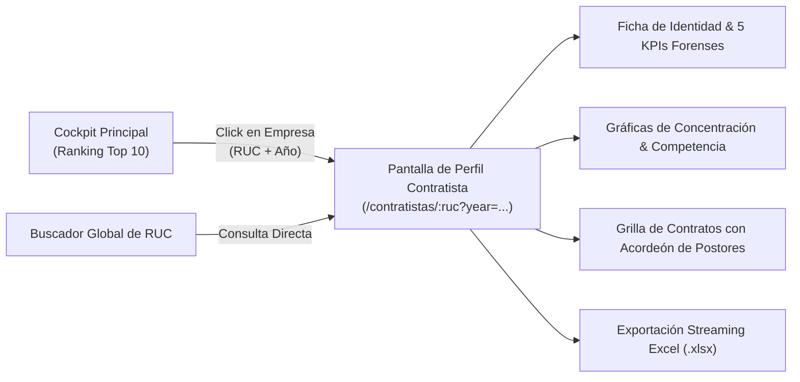

# User Story: Pantalla Secundaria de Perfil y Auditoría Forense de Contratista / Empresa

| Metadato | Detalle |
| :--- | :--- |
| **ID de Historia** | `US-CONTRATACIONES-002` |
| **Épica** | Plataforma Forense y Analítica de Contrataciones Públicas del Perú (SEACE) |
| **Módulo** | Auditoría y Perfil Individual de Contratista (Pantalla Secundaria) |
| **Fase** | Fase 2 - Trazabilidad Individual, Red de Rivales, Win Rate y Exportación Forense |
| **Prioridad** | Alta (P1) |
| **Motor BD** | MySQL 8.0+ (Soporte nativo de CTEs, Funciones de Ventana y Subconsultas Correlacionadas) |
| **Stack Tecnológico** | Node.js (`mysql2/promise`, `exceljs`) / Next.js - React (Apache ECharts, Lucide React, Tailwind CSS) |
| **Estado** | Listo para Implementación (Ready for Dev) |
| **Script SQL de Consola** | [perfil_contratista_consultas.sql](file:///C:/Users/GIUY23/DataGripProjects/LOCAL/perfil_contratista_consultas.sql) / `console_6.sql` |

---

## 1. Narrativa Ágil (User Story Narrative)

> **COMO** Auditor Forense, Analista de Inteligencia de Mercado y Oficial de Cumplimiento (*Compliance*),  
> **QUIERO** una pantalla dedicada a la auditoría individual de cualquier empresa contratista del Estado peruano (precargada al hacer clic en el ranking del Cockpit principal o buscada mediante su RUC),  
> **PARA** examinar su concentración de clientes institucionales, tasa de postor único, porcentaje de éxito (*Win Rate*), red de competidores habituales y descargar el expediente completo en un archivo Excel auditado con precisión contable al 100%.



---

## 2. Criterios de Aceptación (Gherkin - Acceptance Criteria)

### Escenario 1: Navegación y Precarga de Parámetros
* **DADO QUE** el usuario hace clic en una empresa del ranking de la pantalla principal,
* **CUANDO** el sistema redirige a `/contratistas/:ruc?year=2024`,
* **ENTONCES** la pantalla debe precargar automáticamente la ficha del contratista para ese año fiscal,
* **Y** permitir al auditor cambiar el selector de año a cualquier periodo (`2022`, `2023`, `2024`, `2025`, `2026`) o seleccionar `"Todo el Histórico"` (`year=all` / `NULL`),
* **Y** disponer de una barra de búsqueda para digitar cualquier otro RUC (11 dígitos) con autocompletado y validación de existencia.

### Escenario 2: Ficha de Identidad y Tarjetas KPI Forenses (1 Round-Trip)
* **DADO QUE** se solicita el resumen del contratista (`GET /api/v1/contratistas/:ruc/summary`),
* **CUANDO** se procesan los datos en la base de datos,
* **ENTONCES** debe retornar en una sola consulta optimizada:
  1. Identidad: RUC, Razón Social formal, Tipo de Proveedor (`INDIVIDUAL` o `CONSORCIO`) y Departamento de la sede principal.
  2. `Total Contratos`: Cantidad de contratos formalizados suscritos en el periodo.
  3. `Monto Total Adjudicado (S/)`: Suma de importes suscritos (`monto_contratado_item`).
  4. `Entidades Públicas Clientes`: Cantidad de entidades distintas a las que ha contratado.
  5. `Tasa de Postor Único (%)`: Porcentaje de sus contratos donde fue el único oferente registrado en `ofertantes` (*Bandera roja de falta de competencia*).
  6. `Win Rate Forense (%)`: Porcentaje de efectividad $\left(\frac{\text{Contratos Ganados}}{\text{Propuestas Presentadas}}\right) \times 100$.

### Escenario 3: Gráfica de Concentración de Clientes (Captura Institucional)
* **DADO QUE** se visualiza la distribución de ingresos del contratista,
* **CUANDO** se carga la gráfica de Clientes Principales (`GET /api/v1/contratistas/:ruc/clientes`),
* **ENTONCES** debe listar las entidades públicas agrupadas por RUC y Nombre, indicando el número de contratos, el monto acumulado en Soles y el `%` relativo sobre la facturación total de la empresa en ese periodo, ordenado descendentemente por monto.

### Escenario 4: Gráfica de Distribución Geográfica / Territorial
* **DADO QUE** se evalúa el radio territorial del contratista,
* **CUANDO** se consulta la distribución geográfica (`GET /api/v1/contratistas/:ruc/territorio`),
* **ENTONCES** debe agrupar los contratos por `departamento_item` (resolviendo `"NO ESPECIFICADO"` si es nulo), con su respectivo monto acumulado y porcentaje de participación territorial.

### Escenario 5: Línea de Tiempo Multianual (Evolución Histórica 2022 - 2026)
* **DADO QUE** se busca detectar crecimientos anómalos o sospechosos,
* **CUANDO** se consulta la línea de tiempo (`GET /api/v1/contratistas/:ruc/timeline`),
* **ENTONCES** la consulta debe retornar la evolución histórica de todos los años disponibles (2022 al 2026), independientemente del filtro de año activo, mostrando contratos, monto formalizado y entidades atendidas por año.

### Escenario 6: Red Forense de Co-licitadores / Competidores Frecuentes (*Bid Rigging Check*)
* **DADO QUE** se investiga la existencia de posibles consorcios encubiertos o pactos colusorios,
* **CUANDO** se carga el panel de competidores (`GET /api/v1/contratistas/:ruc/competidores`),
* **ENTONCES** el backend debe identificar a los rivales que más veces coincidieron en los mismos procesos licitados (`codigo_convocatoria`, `numero_item`), indicando las veces que compitieron juntos, cuántas veces ganó la empresa consultada y cuántas veces ganó el competidor.

### Escenario 7: Grilla Detallada de Expedientes con Acordeón de Postores
* **DADO QUE** el auditor inspecciona cada contrato individual,
* **CUANDO** visualiza la tabla paginada (`GET /api/v1/contratistas/:ruc/contratos`),
* **ENTONCES** cada fila debe mostrar: Código de contrato, Número de contrato, Entidad convocante, Objeto contractual, Tipo de proceso, Ubicación, Fecha de suscripción, Monto adjudicado, Indicador de postor único, Alerta de resolución contractual y enlace oficial a SEACE,
* **Y** al desplegar una fila (acordeón), debe cargar bajo demanda la lista de todos los postores que compitieron en ese ítem con su fecha de postulación y si obtuvieron la adjudicación.

### Escenario 8: Exportación Forense a Excel (.xlsx) por Streaming
* **DADO QUE** el auditor requiere exportar la evidencia contractual,
* **CUANDO** hace clic en `"Exportar a Excel (.xlsx)"`,
* **ENTONCES** la descarga debe generarse desde el backend mediante streaming con la librería `exceljs` (`stream.xlsx.WorkbookWriter`),
* **Y** las celdas numéricas deben formatearse estrictamente con formato de moneda peruana `S/ #,##0.00`,
* **Y** la fila de totales debe incluir una fórmula nativa de Excel `=SUM(...)` para garantizar consistencia contable al 100%.

---

## 3. Arquitectura de Consultas SQL Optimizadas (MySQL 8.0+)

> [!NOTE]
> Las consultas operan sobre los índices ya existentes en `contratos` (`idx_contratos_contratista_monto`, `idx_contratos_fecha_sub`), `organizaciones` (`uk_numero_documento`), `ofertantes` (`PRIMARY (codigo_convocatoria, numero_item, id_postor)`) y la vista analítica `convocatorias`.

### 3.1. Query 1: Ficha de Identidad y KPIs Consolidados (1 Round-Trip)
```sql
WITH info_empresa AS (
    SELECT 
        o.id_organizacion,
        o.numero_documento AS ruc,
        o.razon_social,
        COALESCE(
            CASE 
                WHEN o.tipo_proveedor LIKE '%CONSORCIO%' OR o.razon_social LIKE '%CONSORCIO%' THEN 'CONSORCIO'
                ELSE 'INDIVIDUAL'
            END, 'INDIVIDUAL'
        ) AS tipo_proveedor,
        COALESCE(o.departamento_sede, 'NO REGISTRADO') AS departamento_sede
    FROM contrataciones.organizaciones o
    WHERE o.numero_documento = :ruc
    LIMIT 1
),
contratos_empresa AS (
    SELECT 
        c.codigo_contrato,
        c.numero_item,
        c.codigo_convocatoria,
        c.monto_contratado_item,
        conv.ruc_entidad,
        (
            SELECT COUNT(*) 
            FROM contrataciones.ofertantes ofe 
            WHERE ofe.codigo_convocatoria = c.codigo_convocatoria 
              AND ofe.numero_item = c.numero_item
        ) AS cant_postores
    FROM contrataciones.contratos c
    JOIN info_empresa ie ON c.id_contratista = ie.id_organizacion
    LEFT JOIN contrataciones.convocatorias conv 
        ON c.codigo_convocatoria = conv.codigo_convocatoria 
       AND c.numero_item = conv.numero_item
    WHERE (:year IS NULL OR YEAR(c.fecha_suscripcion_contrato) = :year)
),
postulaciones_empresa AS (
    SELECT 
        COUNT(DISTINCT ofe.codigo_convocatoria, ofe.numero_item) AS total_postulaciones
    FROM contrataciones.ofertantes ofe
    JOIN info_empresa ie ON ofe.id_postor = ie.id_organizacion
    WHERE (:year IS NULL OR YEAR(ofe.fecha_presentacion_propuesta) = :year)
)
SELECT 
    ie.ruc,
    ie.razon_social,
    ie.tipo_proveedor,
    ie.departamento_sede,
    COUNT(ce.codigo_contrato) AS total_contratos,
    COALESCE(SUM(ce.monto_contratado_item), 0.00) AS monto_total_soles,
    COUNT(DISTINCT ce.ruc_entidad) AS entidades_distintas,
    ROUND(
        COALESCE(
            (SUM(CASE WHEN ce.cant_postores = 1 THEN 1 ELSE 0 END) * 100.0) / NULLIF(COUNT(ce.codigo_contrato), 0),
            0.00
        ), 1
    ) AS tasa_postor_unico_pct,
    COALESCE(pe.total_postulaciones, 0) AS total_postulaciones,
    ROUND(
        COALESCE(
            (COUNT(ce.codigo_contrato) * 100.0) / NULLIF(pe.total_postulaciones, 0),
            0.00
        ), 1
    ) AS win_rate_pct
FROM info_empresa ie
LEFT JOIN contratos_empresa ce ON 1=1
LEFT JOIN postulaciones_empresa pe ON 1=1
GROUP BY 
    ie.ruc, ie.razon_social, ie.tipo_proveedor, ie.departamento_sede, pe.total_postulaciones;
```

---

### 3.2. Query 2: Concentración por Entidades Públicas (Clientes Principales)
```sql
WITH empresa_base AS (
    SELECT id_organizacion FROM contrataciones.organizaciones WHERE numero_documento = :ruc LIMIT 1
),
contratos_empresa AS (
    SELECT 
        conv.ruc_entidad,
        conv.nombre_entidad,
        c.codigo_contrato,
        c.numero_item,
        c.monto_contratado_item
    FROM contrataciones.contratos c
    JOIN empresa_base eb ON c.id_contratista = eb.id_organizacion
    JOIN contrataciones.convocatorias conv 
        ON c.codigo_convocatoria = conv.codigo_convocatoria 
       AND c.numero_item = conv.numero_item
    WHERE (:year IS NULL OR YEAR(c.fecha_suscripcion_contrato) = :year)
)
SELECT 
    ruc_entidad,
    nombre_entidad,
    COUNT(DISTINCT codigo_contrato, numero_item) AS total_contratos,
    COALESCE(SUM(monto_contratado_item), 0.00) AS monto_total_soles,
    ROUND(
        (SUM(monto_contratado_item) * 100.0) / 
        NULLIF(SUM(SUM(monto_contratado_item)) OVER(), 0), 
        2
    ) AS porcentaje_sobre_empresa
FROM contratos_empresa
GROUP BY ruc_entidad, nombre_entidad
ORDER BY monto_total_soles DESC;
```

---

### 3.3. Query 3: Distribución Territorial / Geográfica de sus Contratos
```sql
WITH empresa_base AS (
    SELECT id_organizacion FROM contrataciones.organizaciones WHERE numero_documento = :ruc LIMIT 1
),
contratos_empresa AS (
    SELECT 
        COALESCE(NULLIF(TRIM(conv.departamento_item), ''), 'NO ESPECIFICADO') AS departamento,
        c.codigo_contrato,
        c.numero_item,
        c.monto_contratado_item
    FROM contrataciones.contratos c
    JOIN empresa_base eb ON c.id_contratista = eb.id_organizacion
    JOIN contrataciones.convocatorias conv 
        ON c.codigo_convocatoria = conv.codigo_convocatoria 
       AND c.numero_item = conv.numero_item
    WHERE (:year IS NULL OR YEAR(c.fecha_suscripcion_contrato) = :year)
)
SELECT 
    departamento,
    COUNT(DISTINCT codigo_contrato, numero_item) AS total_contratos,
    COALESCE(SUM(monto_contratado_item), 0.00) AS monto_total_soles,
    ROUND(
        (SUM(monto_contratado_item) * 100.0) / 
        NULLIF(SUM(SUM(monto_contratado_item)) OVER(), 0), 
        2
    ) AS porcentaje
FROM contratos_empresa
GROUP BY departamento
ORDER BY monto_total_soles DESC;
```

---

### 3.4. Query 4: Evolución Histórica Anual de la Empresa (Línea de Tiempo 2022-2026)
```sql
WITH empresa_base AS (
    SELECT id_organizacion FROM contrataciones.organizaciones WHERE numero_documento = :ruc LIMIT 1
)
SELECT 
    YEAR(c.fecha_suscripcion_contrato) AS year,
    COUNT(DISTINCT c.codigo_contrato, c.numero_item) AS total_contratos,
    COALESCE(SUM(c.monto_contratado_item), 0.00) AS monto_total_soles,
    COUNT(DISTINCT conv.ruc_entidad) AS entidades_atendidas
FROM contrataciones.contratos c
JOIN empresa_base eb ON c.id_contratista = eb.id_organizacion
LEFT JOIN contrataciones.convocatorias conv 
    ON c.codigo_convocatoria = conv.codigo_convocatoria 
   AND c.numero_item = conv.numero_item
WHERE c.fecha_suscripcion_contrato IS NOT NULL
GROUP BY YEAR(c.fecha_suscripcion_contrato)
ORDER BY year ASC;
```

---

### 3.5. Query 5: Red Forense de Rivales Habituales (*Bid Rigging Check*)
```sql
WITH empresa_base AS (
    SELECT id_organizacion FROM contrataciones.organizaciones WHERE numero_documento = :ruc LIMIT 1
),
items_empresa AS (
    SELECT 
        o.codigo_convocatoria, 
        o.numero_item
    FROM contrataciones.ofertantes o
    JOIN empresa_base eb ON o.id_postor = eb.id_organizacion
    WHERE (:year IS NULL OR YEAR(o.fecha_presentacion_propuesta) = :year)
),
rivales AS (
    SELECT 
        o_rival.id_postor,
        ie.codigo_convocatoria,
        ie.numero_item
    FROM items_empresa ie
    JOIN contrataciones.ofertantes o_rival 
        ON ie.codigo_convocatoria = o_rival.codigo_convocatoria 
       AND ie.numero_item = o_rival.numero_item
    JOIN empresa_base eb ON o_rival.id_postor != eb.id_organizacion
),
ganadores_items AS (
    SELECT 
        adj.codigo_convocatoria,
        adj.numero_item,
        adj.id_proveedor AS id_ganador
    FROM contrataciones.adjudicaciones adj
    JOIN items_empresa ie 
        ON adj.codigo_convocatoria = ie.codigo_convocatoria 
       AND adj.numero_item = ie.numero_item
)
SELECT 
    org.numero_documento AS ruc_rival,
    org.razon_social AS rival,
    COUNT(DISTINCT r.codigo_convocatoria, r.numero_item) AS procesos_competidos,
    COUNT(DISTINCT CASE WHEN g.id_ganador = eb.id_organizacion THEN CONCAT(r.codigo_convocatoria, '-', r.numero_item) END) AS victorias_empresa_consultada,
    COUNT(DISTINCT CASE WHEN g.id_ganador = r.id_postor THEN CONCAT(r.codigo_convocatoria, '-', r.numero_item) END) AS victorias_rival
FROM rivales r
JOIN empresa_base eb ON 1=1
JOIN contrataciones.organizaciones org ON r.id_postor = org.id_organizacion
LEFT JOIN ganadores_items g 
    ON r.codigo_convocatoria = g.codigo_convocatoria 
   AND r.numero_item = g.numero_item
GROUP BY org.id_organizacion, org.numero_documento, org.razon_social, eb.id_organizacion
ORDER BY procesos_competidos DESC
LIMIT 10;
```

---

### 3.6. Query 6: Grilla Detallada de Contratos (Paginada y Exportable)
```sql
WITH empresa_base AS (
    SELECT id_organizacion FROM contrataciones.organizaciones WHERE numero_documento = :ruc LIMIT 1
)
SELECT 
    c.codigo_contrato,
    c.numero_contrato,
    c.codigo_convocatoria,
    c.numero_item,
    conv.ruc_entidad,
    conv.nombre_entidad,
    conv.objeto_contractual,
    conv.tipo_proceso_seleccion,
    conv.descripcion_item,
    COALESCE(conv.departamento_item, 'NO REGISTRADO') AS departamento_item,
    COALESCE(conv.provincia_item, 'NO REGISTRADO') AS provincia_item,
    c.fecha_suscripcion_contrato,
    c.monto_contratado_item,
    COALESCE(sub_ofert.cant_postores, 0) AS cantidad_postores,
    CASE WHEN COALESCE(sub_ofert.cant_postores, 0) = 1 THEN 1 ELSE 0 END AS es_postor_unico,
    COALESCE(c.tiene_resolucion, 'NO') AS tiene_resolucion,
    c.url_contrato
FROM contrataciones.contratos c
JOIN empresa_base eb ON c.id_contratista = eb.id_organizacion
LEFT JOIN contrataciones.convocatorias conv 
    ON c.codigo_convocatoria = conv.codigo_convocatoria 
   AND c.numero_item = conv.numero_item
LEFT JOIN (
    SELECT 
        o.codigo_convocatoria, 
        o.numero_item, 
        COUNT(DISTINCT o.id_postor) AS cant_postores
    FROM contrataciones.ofertantes o
    GROUP BY o.codigo_convocatoria, o.numero_item
) sub_ofert 
    ON c.codigo_convocatoria = sub_ofert.codigo_convocatoria 
   AND c.numero_item = sub_ofert.numero_item
WHERE (:year IS NULL OR YEAR(c.fecha_suscripcion_contrato) = :year)
ORDER BY c.fecha_suscripcion_contrato DESC, c.monto_contratado_item DESC
LIMIT :limit OFFSET :offset;
```

---

### 3.7. Query 7: Postores de un Ítem Específico (Sub-fila Expandible)
```sql
SELECT 
    org.numero_documento AS ruc_postor,
    org.razon_social AS postor,
    o.fecha_presentacion_propuesta,
    CASE WHEN adj.id_proveedor IS NOT NULL THEN 1 ELSE 0 END AS fue_adjudicado,
    adj.monto_adjudicado_item_soles
FROM contrataciones.ofertantes o
JOIN contrataciones.organizaciones org ON o.id_postor = org.id_organizacion
LEFT JOIN contrataciones.adjudicaciones adj 
    ON o.codigo_convocatoria = adj.codigo_convocatoria 
   AND o.numero_item = adj.numero_item 
   AND o.id_postor = adj.id_proveedor
WHERE o.codigo_convocatoria = :codigo_convocatoria 
  AND o.numero_item = :numero_item
ORDER BY fue_adjudicado DESC, o.fecha_presentacion_propuesta ASC;
```

---

## 4. Contratos de API REST (Endpoints Backend)

### 4.1. `GET /api/v1/contratistas/:ruc/summary`
* **Query Params**: `year` (`2022`, `2023`, `2024`, `2025`, `2026`, o `'all'`)
* **Response `200 OK`**:
```json
{
  "ruc": "20100041953",
  "razon_social": "RIMAC SEGUROS Y REASEGUROS",
  "tipo_proveedor": "INDIVIDUAL",
  "departamento_sede": "LIMA",
  "total_contratos": 31,
  "monto_total_soles": 28338714.08,
  "entidades_distintas": 26,
  "tasa_postor_unico_pct": 45.2,
  "total_postulaciones": 121,
  "win_rate_pct": 25.6
}
```

### 4.2. `GET /api/v1/contratistas/:ruc/clientes`
* **Response `200 OK`**:
```json
[
  {
    "ruc_entidad": "20131379944",
    "nombre_entidad": "MINISTERIO DE TRANSPORTES Y COMUNICACIONES",
    "total_contratos": 4,
    "monto_total_soles": 7682396.66,
    "porcentaje_sobre_empresa": 27.11
  },
  {
    "ruc_entidad": "20165465009",
    "nombre_entidad": "POLICIA NACIONAL DEL PERÚ - DIRECCIÓN DE ECONOMÍA Y FINANZAS",
    "total_contratos": 1,
    "monto_total_soles": 3777270.64,
    "porcentaje_sobre_empresa": 13.33
  }
]
```

### 4.3. `GET /api/v1/contratistas/:ruc/competidores`
* **Response `200 OK`**:
```json
[
  {
    "ruc_rival": "20100210909",
    "rival": "LA POSITIVA SEGUROS Y REASEGUROS S.A.",
    "procesos_competidos": 43,
    "victorias_empresa_consultada": 25,
    "victorias_rival": 11
  },
  {
    "ruc_rival": "20418896915",
    "rival": "MAPFRE PERU VIDA COMPAÑIA DE SEGUROS Y REASEGUROS",
    "procesos_competidos": 39,
    "victorias_empresa_consultada": 21,
    "victorias_rival": 8
  }
]
```

---

## 5. Implementación del Servicio de Exportación a Excel con Streaming (`exceljs`)

```typescript
import { Request, Response } from 'express';
import ExcelJS from 'exceljs';
import { pool } from '../config/database';

export async function exportarContratosExcel(req: Request, res: Response): Promise<void> {
  const { ruc } = req.params;
  const yearParam = req.query.year === 'all' || !req.query.year ? null : Number(req.query.year);

  // Configurar encabezados HTTP para streaming de descarga
  const fileName = `auditoria_contratista_${ruc}_${yearParam ?? 'historico'}.xlsx`;
  res.setHeader('Content-Type', 'application/vnd.openxmlformats-officedocument.spreadsheetml.sheet');
  res.setHeader('Content-Disposition', `attachment; filename="${fileName}"`);

  // Instanciar WorkbookWriter para consumo de memoria O(1)
  const workbook = new ExcelJS.stream.xlsx.WorkbookWriter({
    stream: res,
    useStyles: true,
    useSharedStrings: true
  });

  const worksheet = workbook.addWorksheet('Auditoría Contratos');

  // Definir columnas con anchos proporcionales
  worksheet.columns = [
    { header: 'Cód. Contrato', key: 'codigo_contrato', width: 14 },
    { header: 'N° Contrato', key: 'numero_contrato', width: 22 },
    { header: 'Cód. Convocatoria', key: 'codigo_convocatoria', width: 16 },
    { header: 'Ítem', key: 'numero_item', width: 8 },
    { header: 'RUC Entidad', key: 'ruc_entidad', width: 14 },
    { header: 'Entidad Pública', key: 'nombre_entidad', width: 40 },
    { header: 'Objeto', key: 'objeto_contractual', width: 14 },
    { header: 'Tipo Proceso', key: 'tipo_proceso_seleccion', width: 24 },
    { header: 'Descripción del Ítem', key: 'descripcion_item', width: 45 },
    { header: 'Departamento', key: 'departamento_item', width: 18 },
    { header: 'Provincia', key: 'provincia_item', width: 18 },
    { header: 'Fecha Suscripción', key: 'fecha_suscripcion_contrato', width: 16 },
    { header: 'Monto Formalizado (S/)', key: 'monto_contratado_item', width: 22 },
    { header: 'Postores', key: 'cantidad_postores', width: 10 },
    { header: 'Postor Único', key: 'es_postor_unico', width: 13 },
    { header: 'Tiene Resolución', key: 'tiene_resolucion', width: 15 },
    { header: 'Enlace SEACE', key: 'url_contrato', width: 50 }
  ];

  // Estilo de Cabecera Oficial (Azul corporativo #1E3A8A)
  const headerRow = worksheet.getRow(1);
  headerRow.font = { name: 'Calibri', size: 11, bold: true, color: { argb: 'FFFFFFFF' } };
  headerRow.fill = {
    type: 'pattern',
    pattern: 'solid',
    fgColor: { argb: 'FF1E3A8A' }
  };
  headerRow.alignment = { vertical: 'middle', horizontal: 'center' };
  headerRow.commit();

  // Ejecución de la consulta por lotes o stream
  const sql = `
    WITH empresa_base AS (
        SELECT id_organizacion FROM contrataciones.organizaciones WHERE numero_documento = ? LIMIT 1
    )
    SELECT 
        c.codigo_contrato,
        c.numero_contrato,
        c.codigo_convocatoria,
        c.numero_item,
        conv.ruc_entidad,
        conv.nombre_entidad,
        conv.objeto_contractual,
        conv.tipo_proceso_seleccion,
        conv.descripcion_item,
        COALESCE(conv.departamento_item, 'NO REGISTRADO') AS departamento_item,
        COALESCE(conv.provincia_item, 'NO REGISTRADO') AS provincia_item,
        c.fecha_suscripcion_contrato,
        c.monto_contratado_item,
        COALESCE(sub_ofert.cant_postores, 0) AS cantidad_postores,
        CASE WHEN COALESCE(sub_ofert.cant_postores, 0) = 1 THEN 'SÍ' ELSE 'NO' END AS es_postor_unico,
        COALESCE(c.tiene_resolucion, 'NO') AS tiene_resolucion,
        c.url_contrato
    FROM contrataciones.contratos c
    JOIN empresa_base eb ON c.id_contratista = eb.id_organizacion
    LEFT JOIN contrataciones.convocatorias conv 
        ON c.codigo_convocatoria = conv.codigo_convocatoria 
       AND c.numero_item = conv.numero_item
    LEFT JOIN (
        SELECT o.codigo_convocatoria, o.numero_item, COUNT(DISTINCT o.id_postor) AS cant_postores
        FROM contrataciones.ofertantes o
        GROUP BY o.codigo_convocatoria, o.numero_item
    ) sub_ofert ON c.codigo_convocatoria = sub_ofert.codigo_convocatoria AND c.numero_item = sub_ofert.numero_item
    WHERE (? IS NULL OR YEAR(c.fecha_suscripcion_contrato) = ?)
    ORDER BY c.fecha_suscripcion_contrato DESC;
  `;

  const [rows] = await pool.query<any[]>(sql, [ruc, yearParam, yearParam]);

  let currentRow = 2;
  for (const r of rows) {
    const row = worksheet.addRow({
      codigo_contrato: r.codigo_contrato,
      numero_contrato: r.numero_contrato,
      codigo_convocatoria: r.codigo_convocatoria,
      numero_item: r.numero_item,
      ruc_entidad: r.ruc_entidad,
      nombre_entidad: r.nombre_entidad,
      objeto_contractual: r.objeto_contractual,
      tipo_proceso_seleccion: r.tipo_proceso_seleccion,
      descripcion_item: r.descripcion_item,
      departamento_item: r.departamento_item,
      provincia_item: r.provincia_item,
      fecha_suscripcion_contrato: r.fecha_suscripcion_contrato ? new Date(r.fecha_suscripcion_contrato) : null,
      monto_contratado_item: Number(r.monto_contratado_item),
      cantidad_postores: Number(r.cantidad_postores),
      es_postor_unico: r.es_postor_unico,
      tiene_resolucion: r.tiene_resolucion,
      url_contrato: r.url_contrato
    });

    // Formato de Moneda Peruana Estricto en la celda de Monto
    const celdaMonto = row.getCell('monto_contratado_item');
    celdaMonto.numFmt = '_("S/"* #,##0.00_);_("S/"* \(#,##0.00\);_("S/"* "-"??_);_(@_)';
    celdaMonto.alignment = { horizontal: 'right' };

    // Formato de Fecha
    const celdaFecha = row.getCell('fecha_suscripcion_contrato');
    celdaFecha.numFmt = 'yyyy-mm-dd';
    celdaFecha.alignment = { horizontal: 'center' };

    // Alerta visual si fue postor único
    if (r.es_postor_unico === 'SÍ') {
      row.getCell('es_postor_unico').font = { color: { argb: 'FFDC2626' }, bold: true };
    }

    row.commit();
    currentRow++;
  }

  // Fila de Totales con Fórmula Nativa de Excel
  const totalRow = worksheet.addRow({
    descripcion_item: 'TOTAL FORMALIZADO AUDITADO (S/)',
    monto_contratado_item: { formula: `SUM(M2:M${currentRow - 1})` }
  });
  totalRow.font = { bold: true };
  totalRow.getCell('monto_contratado_item').numFmt = '_("S/"* #,##0.00_);_("S/"* \(#,##0.00\);_("S/"* "-"??_);_(@_)';
  totalRow.commit();

  await workbook.commit();
}
```
