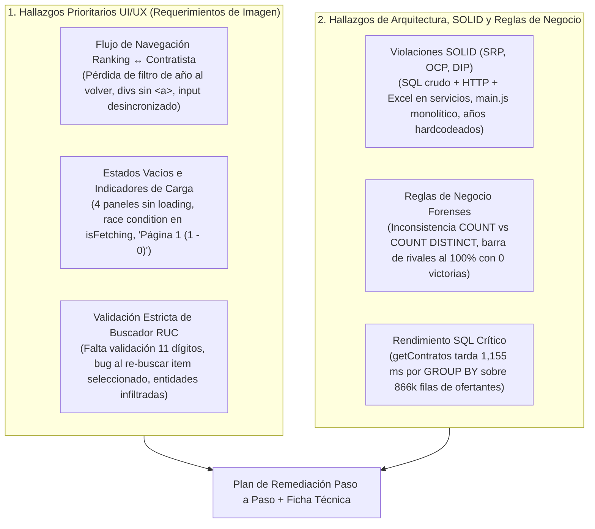

# Reporte de Dogfooding, Auditoría UI/UX y Ficha Técnica de Arquitectura (SOLID & Reglas de Negocio)

| Metadato | Detalle Técnico |
| :--- | :--- |
| **Código de Documento** | `AUDIT-DOGFOODING-001` |
| **Proyecto** | OECE / RONIN.SEACE — Cockpit Forense de Contrataciones del Estado |
| **Módulos Auditados** | Pantalla Principal (`public/index.html`, `public/js/main.js`, `src/cockpit/*`) y Perfil Forense de Contratista (`public/contratista.html`, `public/js/contratista/*`, `src/contratistas/*`) |
| **Fecha de Auditoría** | 23 de Octubre de 2026 |
| **Motor de Base de Datos** | MySQL 8.0+ (`contrataciones`: 229,528 organizaciones, 866,176 ofertantes, 28,216 contratos) |
| **Stack Analizado** | NestJS 11 (`mysql2/promise`, `exceljs`) + Vanilla JS (ES6 Modules) + Tailwind CSS 3.4 |
| **Enfoque de la Auditoría** | Dogfooding E2E sobre flujos críticos de UI/UX (imagen de requerimientos), cumplimiento de principios SOLID, arquitectura en capas, reglas de negocio SEACE y rendimiento SQL |

---

## 1. Resumen Ejecutivo del Dogfooding

Se ejecutó una sesión completa de **dogfooding técnico y funcional** interactuando con el código fuente del cliente (`public/`), los controladores/servicios del servidor (`src/`) y consultas reales sobre la base de datos MySQL `contrataciones`.

### Distribución Real de Datos Detectada en la Base de Datos
Durante las pruebas con datos reales se identificó un factor determinante para la experiencia de usuario (UX):

| Año Fiscal | Contratos Registrados | Comportamiento en Dogfooding |
| :---: | :---: | :--- |
| **2026** *(Default actual)* | **351** | El **99.8% de los contratistas** no tiene contratos en 2026, disparando masivamente estados vacíos. |
| **2025** | **6,217** | Alta densidad de datos operativos. |
| **2024** | **8,001** | Mayor volumen histórico de contratos formalizados. |
| **2023** | **7,639** | Alta densidad de datos operativos. |
| **2022** | **6,006** | Alta densidad de datos operativos. |



---

## 2. Auditoría Detallada UI/UX (Foco en los 3 Puntos de la Imagen)

---

### 2.1. Punto 1: Revisión y ajuste del flujo de navegación al hacer clic en una empresa del ranking Principal hacia `contratista.html`, conservando el filtro del año fiscal seleccionado

#### A. Diagnóstico de Dogfooding (Problemas Detectados)
1. **Pérdida del filtro de año fiscal en el retorno (`contratista.html` → `index.html`)**:
   - Cuando el usuario filtra por ejemplo el año `2024` en [index.html](file:///d:/UTP/II%20CICLO/SOFTWARE%20I/PROJECT/contracts/frontend/public/index.html) y hace clic en una empresa del Top 10, navega hacia `contratista.html?ruc=20100041953&year=2024`.
   - Sin embargo, al hacer clic en **`← VOLVER A VISIÓN GENERAL`** ([contratista.html](file:///d:/UTP/II%20CICLO/SOFTWARE%20I/PROJECT/contracts/frontend/public/contratista.html#L173-L176)), en la pestaña **`01. VISIÓN GENERAL`** ([contratista.html](file:///d:/UTP/II%20CICLO/SOFTWARE%20I/PROJECT/contracts/frontend/public/contratista.html#L153-L155)) o en el isotipo superior ([contratista.html](file:///d:/UTP/II%20CICLO/SOFTWARE%20I/PROJECT/contracts/frontend/public/contratista.html#L131-L140)), todos apuntan estáticamente a `/index.html` **sin el parámetro `?year=`**.
   - Adicionalmente, [`setupYearSelector()`](file:///d:/UTP/II%20CICLO/SOFTWARE%20I/PROJECT/contracts/frontend/public/js/main.js#L17-L32) en `main.js` **no lee `URLSearchParams`**, forzando siempre `2026` al cargar la pantalla principal y perdiendo el contexto de auditoría.
2. **Pérdida de parámetros al hacer clic en la pestaña activa `02. PERFIL CONTRATISTA`**:
   - En [contratista.html](file:///d:/UTP/II%20CICLO/SOFTWARE%20I/PROJECT/contracts/frontend/public/contratista.html#L157-L160), el enlace `<a href="/contratista.html">` carece de parámetros, por lo que un clic accidental borra el `ruc` y el `year` activos.
3. **Uso de `<div onclick="window.location.href=...">` en lugar de hipervínculos semánticos `<a>` en el Ranking Principal**:
   - En [`renderTopContratistas()`](file:///d:/UTP/II%20CICLO/SOFTWARE%20I/PROJECT/contracts/frontend/public/js/main.js#L319-L323), cada fila del ranking es un `<div>` con un `onclick` inline. Esto impide al auditor abrir múltiples empresas del ranking en pestañas nuevas con `Ctrl + Click` o clic central del ratón, impide navegar con teclado (`Tab` + `Enter`) y oculta la URL destino.
4. **Falta de sincronización visual del buscador al llegar desde el Ranking**:
   - Al entrar a `contratista.html?ruc=20100041953&year=2024`, el input `#searchContratistaInput` queda vacío en vez de reflejar el RUC/Razón Social de la empresa cargada.
5. **Rivales no navegables**:
   - En [`RivalsPanelComponent.render()`](file:///d:/UTP/II%20CICLO/SOFTWARE%20I/PROJECT/contracts/frontend/public/js/contratista/rivals-panel.js#L28-L61), las tarjetas de rivales muestran el `ruc_rival`, pero no permiten hacer clic para auditar a dicho competidor conservando el año fiscal activo.

#### B. Solución Paso a Paso (Punto 1)
1. **En `public/js/main.js`**:
   - Actualizar `setupYearSelector()` para leer `new URLSearchParams(window.location.search).get('year')` y validar que sea un año válido (`2022`–`2026`), sincronizando además la URL con `window.history.replaceState` cada vez que cambie `#filterYear`.
   - En `renderTopContratistas()`, reemplazar el `<div onclick="...">` contenedor de cada contratista por un elemento semántico `<a href="/contratista.html?ruc=${encodeURIComponent(item.ruc)}&year=${encodeURIComponent(currentYear)}" class="block group ...">`.
2. **En `public/contratista.html` y `public/js/contratista/app.js`**:
   - Suscribir un actualizador de enlaces de navegación (`updateNavigationLinks()`) a los eventos `rucChanged` y `yearChanged` de `state` para que todos los enlaces de retorno a `/index.html` incluyan `?year=${state.year}` (si `state.year !== 'all'`), y el enlace a `/contratista.html` conserve `?ruc=${state.ruc}&year=${state.year}`.
   - Al recibir los datos de `summary`, poblar `#searchContratistaInput` con `${summary.ruc} - ${summary.razon_social}` (si el usuario no tiene el foco activo escribiendo en el input).

---

### 2.2. Punto 2: Implementación de estados vacíos e indicadores de carga cuando una consulta no arroja registros en un año determinado

#### A. Diagnóstico de Dogfooding (Problemas Detectados)
1. **4 de los 6 paneles de `contratista.html` carecen de indicador de carga (`renderLoading`)**:
   - En [`ContratistaApp.loadAllData()`](file:///d:/UTP/II%20CICLO/SOFTWARE%20I/PROJECT/contracts/frontend/public/js/contratista/app.js#L106-L107), únicamente se invoca `KpiSidebarComponent.renderLoading()` y `ContractsTableComponent.renderLoading()`.
   - Los componentes [`DonutChartComponent`](file:///d:/UTP/II%20CICLO/SOFTWARE%20I/PROJECT/contracts/frontend/public/js/contratista/donut-chart.js), [`TimelineEventsComponent`](file:///d:/UTP/II%20CICLO/SOFTWARE%20I/PROJECT/contracts/frontend/public/js/contratista/timeline-events.js), [`ClientsPanelComponent`](file:///d:/UTP/II%20CICLO/SOFTWARE%20I/PROJECT/contracts/frontend/public/js/contratista/clients-panel.js) y [`RivalsPanelComponent`](file:///d:/UTP/II%20CICLO/SOFTWARE%20I/PROJECT/contracts/frontend/public/js/contratista/rivals-panel.js) **no tienen método `renderLoading()`**, manteniendo en pantalla los gráficos de la consulta previa hasta que terminan las 6 promesas.
   - En `index.html` ([`fetchCockpitData()`](file:///d:/UTP/II%20CICLO/SOFTWARE%20I/PROJECT/contracts/frontend/public/js/main.js#L194-L228)), cambiar cualquier filtro no muestra ningún indicador de carga en KPIs ni en las 3 gráficas.
2. **Condición de carrera y bloqueo silencioso por `this.isFetching` en `app.js`**:
   - En [`ContratistaApp.loadAllData()`](file:///d:/UTP/II%20CICLO/SOFTWARE%20I/PROJECT/contracts/frontend/public/js/contratista/app.js#L96-L98):
     ```javascript
     if (this.isFetching) return;
     this.isFetching = true;
     ```
     Si el usuario cambia el selector de año fiscal o selecciona una empresa en el buscador mientras una petición inicial sigue en vuelo, la nueva consulta **se descarta silenciosamente**, dejando la UI desincronizada respecto al filtro seleccionado.
3. **Estados vacíos mudos (sin contexto ni Call-To-Action) cuando una consulta arroja 0 registros en un año determinado**:
   - Cuando una empresa existe en la base de datos (`summary.ruc` válido) pero tiene `total_contratos === 0` en el año consultado (caso muy frecuente en `2026`), los paneles muestran solo una línea de texto gris sin indicar el año filtrado ni ofrecer un botón directo para **"Consultar Todo el Histórico (2022 - 2026)"** o saltar al último año con contratos registrados en su `timeline`.
4. **Bug visual en paginación vacía (`Página 1 (1 - 0)`) y botón de exportación Excel habilitado sin datos**:
   - En [`ContractsTableComponent.render()`](file:///d:/UTP/II%20CICLO/SOFTWARE%20I/PROJECT/contracts/frontend/public/js/contratista/contracts-table.js#L38-L40), se calcula `offset + 1` antes de verificar si `contratos.length === 0`, renderizando `Página 1 (1 - 0)`.
   - Asimismo, cuando `total_contratos === 0`, el botón `#btnExportExcel` permite descargar un archivo `.xlsx` vacío sin advertencia.

#### B. Solución Paso a Paso (Punto 2)
1. **Reemplazar el bloqueo `this.isFetching` por control de concurrencia con `requestId` / `AbortController`**:
   - Incrementar `this.currentRequestId = ++this.requestCounter` al iniciar `loadAllData()`. Si al resolverse `Promise.all` el `requestId !== this.currentRequestId`, ignorar la respuesta obsoleta sin bloquear las nuevas selecciones del usuario.
2. **Implementar `renderLoading()` uniforme (Skeletons + Spinner Bushidō `☯`) en todos los componentes**:
   - Añadir `DonutChartComponent.renderLoading()`, `TimelineEventsComponent.renderLoading()`, `ClientsPanelComponent.renderLoading()`, `RivalsPanelComponent.renderLoading()` y estados de carga completos en `KpiSidebarComponent.renderLoading()` y `main.js`.
3. **Implementar Banner y Estados Vacíos Contextuales con Acción Directa**:
   - Si `summary` existe (`summary.ruc`) pero `summary.total_contratos === 0` y `state.year !== 'all'`:
     - Mostrar en los paneles vacíos y sobre la grilla un estado vacío enriquecido que informe: *"El contratista [RAZÓN SOCIAL] (RUC [RUC]) no registra contratos suscritos en el ejercicio fiscal [AÑO]."*
     - Si `timeline` contiene años con contratos (`timeline.length > 0`), mostrar botones de acción rápida: **`[ Ver Todo el Histórico (2022-2026) ]`** (`window.selectFiscalYear('all')`) y **`[ Ir al último año con actividad (${ultimoAnio}) ]`**.
   - Corregir `paginationInfo` en `ContractsTableComponent.render()` para que cuando `contratos.length === 0` muestre `Sin registros (0 - 0)` y deshabilitar visualmente `#btnExportExcel` cuando `total_contratos === 0`.

---

### 2.3. Punto 3: Validación estricta en el buscador global de RUC (formato numérico de 11 dígitos, autocompletado predictivo y mensajes claros cuando el RUC no registra contratos)

#### A. Diagnóstico de Dogfooding (Problemas Detectados)
1. **Falta de validación estricta del formato numérico de 11 dígitos y feedback visual de error**:
   - En [`SearchBarComponent.triggerDirectSearch()`](file:///d:/UTP/II%20CICLO/SOFTWARE%20I/PROJECT/contracts/frontend/public/js/contratista/search-bar.js#L107-L119):
     - Si el usuario presiona `Enter` o clic en `BUSCAR` con el campo vacío, no muestra ningún aviso.
     - Si el usuario ingresa una cadena puramente numérica de longitud distinta a 11 dígitos (ej. `20100041` de 8 dígitos o `201000419531` de 12 dígitos), o un número de 11 dígitos con prefijo inválido en SUNAT (en Perú los RUC válidos inician con `10`, `15`, `17` o `20`), el sistema no valida el formato ni informa el error: lo envía como búsqueda libre y muestra un genérico *"No se encontraron empresas con ese término"*.
2. **Bug crítico al pulsar "BUSCAR" tras elegir una opción del autocompletado**:
   - Cuando el usuario elige una empresa del dropdown, [`window.selectSearchedCompany`](file:///d:/UTP/II%20CICLO/SOFTWARE%20I/PROJECT/contracts/frontend/public/js/contratista/app.js#L81-L86) escribe en el input: `"20100041953 - RIMAC SEGUROS Y REASEGUROS"`.
   - Si el usuario vuelve a presionar `Enter` o hace clic en el botón **`BUSCAR`**, `triggerDirectSearch()` evalúa `/^\d{11}$/.test("20100041953 - RIMAC...")`, obtiene `false`, y ejecuta `performSearch("20100041953 - RIMAC...")`. En el backend, `WHERE o.numero_documento LIKE '%20100041953 - RIMAC%' OR o.razon_social LIKE '%20100041953 - RIMAC%'` no coincide con ninguna columna individual y devuelve **"No se encontraron empresas con ese término"**.
3. **Infiltración de Entidades Públicas Puras en el buscador de Contratistas**:
   - En la tabla `organizaciones` existen **2,943 registros con `tipo_actor = 'ENTIDAD'`** (ministerios, municipalidades, cortes superiores que nunca son contratistas). La consulta [`ContratistasService.search()`](file:///d:/UTP/II%20CICLO/SOFTWARE%20I/PROJECT/contracts/frontend/src/contratistas/contratistas.service.ts#L18-L35) no filtra `WHERE o.tipo_actor IN ('PROVEEDOR', 'AMBOS')`, mostrando entidades estatales con `0 contratos` en el autocompletado de contratistas.
4. **Inyección de atributos en `onclick` inline del autocompletado**:
   - En [`SearchBarComponent.renderDropdown()`](file:///d:/UTP/II%20CICLO/SOFTWARE%20I/PROJECT/contracts/frontend/public/js/contratista/search-bar.js#L88), se interpola `onclick="window.selectSearchedCompany('${item.ruc}', '${this.escapeHtml(item.razon_social)}')"`. Si la razón social contiene comillas o caracteres especiales, rompe el atributo JS o expone vectores XSS.
5. **Mensajes ambiguos e inconsistencia de datos cuando un RUC de 11 dígitos no existe o no registra contratos**:
   - Si el auditor busca un RUC de 11 dígitos que no existe en la base de datos (ej. `20999999999`), `/api/v1/contratistas/20999999999/summary` retorna `404 Not Found`.
   - [`KpiSidebarComponent.renderNotFound()`](file:///d:/UTP/II%20CICLO/SOFTWARE%20I/PROJECT/contracts/frontend/public/js/contratista/kpi-sidebar.js#L117-L126) cambia `#lblRazonSocial` a `'EMPRESA NO REGISTRADA O SIN CONTRATOS EN ESTE PERIODO'`, pero **olvida actualizar `#lblRuc`, `#lblSede`, `#badgeTipoProveedor`, `#barPostorUnico` y `#barWinRate`**, dejando el RUC `20100041953` de la empresa anterior visible debajo del mensaje de "Empresa no registrada".
   - Tampoco distingue entre:
     - **Caso 1**: RUC válido en formato pero **inexistente en el padrón SEACE** (`404`).
     - **Caso 2**: RUC registrado en el padrón SEACE pero **sin contratos en el año seleccionado** (`total_contratos === 0` en el año, pero con historial en otros años).
     - **Caso 3**: RUC registrado en el padrón SEACE (ej. postor que nunca ganó o sin contratos formalizados) con **0 contratos en todo el histórico (2022–2026)**.

#### B. Solución Paso a Paso (Punto 3)
1. **Reglas de Validación Estricta en el Buscador (`SearchBarComponent`)**:
   - Extraer prefijo RUC si el input tiene el patrón `^(\d{11})\s*-\s*.+$` para permitir re-búsqueda limpia.
   - Si el usuario ingresa solo dígitos (`^\d+$`) o intenta buscar un RUC numérico:
     - Validar que tenga **exactamente 11 dígitos** (`/^\d{11}$/`). Si tiene menos o más dígitos (ej. 8 o 12 dígitos), mostrar un mensaje de validación inline debajo del buscador: `"⚠️ Formato de RUC inválido: ingresó N dígitos. El RUC peruano debe contener exactamente 11 dígitos numéricos (ej. 20100041953)."`
     - Validar prefijo SUNAT (`/^(10|15|17|20)\d{9}$/`) y dígito verificador opcional o advertencia clara.
   - Si el texto es alfanumérico (búsqueda por Razón Social), exigir mínimo 3 caracteres válidos.
   - Durante el tipeo de solo números en el autocompletado, mostrar un contador/indicador de dígitos (`8/11 dígitos`) y resaltar coincidencias exactas de RUC.
2. **Diferenciación Clara de Mensajes cuando el RUC no registra contratos**:
   - Actualizar `KpiSidebarComponent.renderNotFound(ruc, currentYear)` para limpiar y sincronizar `#lblRuc` con el RUC buscado, resetear las barras de progreso a `0%` y mostrar un estado específico de **"RUC NO REGISTRADO EN PADRÓN SEACE"**.
   - Cuando la empresa sí existe en `organizaciones` pero `total_contratos === 0`:
     - En el autocompletado: mostrar una etiqueta ámbar `SIN CONTRATOS` en lugar de `0 contratos` gris neutro.
     - En la vista principal: mostrar una alerta destacada indicando claramente si **no registra contratos en el año fiscal seleccionado** (ofreciendo cambiar a otro año con 1 clic) o si **no registra contratos adjudicados en ningún periodo (2022–2026)** (indicando su número de postulaciones registradas en `ofertantes` si participó como postor sin ganar).
3. **Incorporar Acceso al Buscador Global de RUC desde `index.html`**:
   - Añadir en la barra superior de `index.html` un buscador rápido de RUC (11 dígitos o Razón Social) con validación estricta que redirija directamente a `/contratista.html?ruc=...&year=...` conservando el año fiscal activo.

---

## 3. Auditoría de Arquitectura, Principios SOLID, Reglas de Negocio y SQL

### 3.1. Evaluación de Principios SOLID

| Principio | Estado | Hallazgos en el Proyecto (Backend & Frontend) | Cómo Solucionarlo |
| :--- | :---: | :--- | :--- |
| **S — Single Responsibility Principle (SRP)** | ❌ **Incumplido** | 1. [`ContratistasService`](file:///d:/UTP/II%20CICLO/SOFTWARE%20I/PROJECT/contracts/frontend/src/contratistas/contratistas.service.ts) (562 líneas) y [`CockpitService`](file:///d:/UTP/II%20CICLO/SOFTWARE%20I/PROJECT/contracts/frontend/src/cockpit/cockpit.service.ts) (345 líneas) mezclan: parseo de query params, consultas SQL crudas de 60 líneas, mapeo/formateo de moneda (`S/ ... MM`) y escritura directa del stream HTTP con estilos de `ExcelJS`.<br/>2. [`public/js/main.js`](file:///d:/UTP/II%20CICLO/SOFTWARE%20I/PROJECT/contracts/frontend/public/js/main.js) (534 líneas) es un archivo monolítico sin módulos que mezcla estado global, llamadas `fetch`, renderizado HTML, tema oscuro y animación `<canvas>`. | **Backend**: Separar en: `ContratistasController` (HTTP) → `ContratistasService` (Reglas de negocio) → `ContratistasRepository` (Consultas SQL) + `ContratistasExcelService` (Generación de `.xlsx`).<br/>**Frontend**: Modularizar `main.js` en `public/js/cockpit/` y extraer los módulos compartidos `public/js/shared/theme.js`, `public/js/shared/dot-canvas.js` y `public/js/shared/ruc-validator.js`. |
| **O — Open/Closed Principle (OCP)** | ⚠️ **Parcial** | Los años fiscales (`2026`, `2025`, `2024`, `2023`, `2022`) están **hardcodeados en 4 archivos**: `index.html`, `main.js`, `contratista.html` y [`state.js`](file:///d:/UTP/II%20CICLO/SOFTWARE%20I/PROJECT/contracts/frontend/public/js/contratista/state.js#L102). | Centralizar la configuración de periodos fiscales en una constante compartida (`FISCAL_YEARS = ['2026', '2025', '2024', '2023', '2022']`) o endpoint `/api/v1/filtros/anios`. |
| **L — Liskov Substitution Principle (LSP)** | ⚠️ **Parcial** | Los métodos de [`ContratistasService`](file:///d:/UTP/II%20CICLO/SOFTWARE%20I/PROJECT/contracts/frontend/src/contratistas/contratistas.service.ts) y [`CockpitService`](file:///d:/UTP/II%20CICLO/SOFTWARE%20I/PROJECT/contracts/frontend/src/cockpit/cockpit.service.ts) retornan contratos heterogéneos: `CockpitService` envuelve en `{ success: boolean, data: ... }` (devolviendo HTTP 200 incluso cuando hay error SQL en el `catch`), mientras que `ContratistasService` retorna objetos/arrays directos o lanza excepciones HTTP. | Estandarizar las respuestas REST y el manejo de errores mediante un `HttpExceptionFilter` global en NestJS, evitando devolver `HTTP 200 OK` cuando ocurre una falla de base de datos. |
| **I — Interface Segregation Principle (ISP)** | ❌ **Incumplido** | En [`CockpitController`](file:///d:/UTP/II%20CICLO/SOFTWARE%20I/PROJECT/contracts/frontend/src/cockpit/cockpit.controller.ts#L20-L57), los 4 endpoints específicos (`/kpis`, `/top-contratistas`, `/distribucion-procesos`, `/top-entidades`) invocan `getCockpitData(query)`, obligando a ejecutar **las 5 consultas SQL pesadas** cuando el consumidor solo pidió 1 métrica. | Exponer métodos granulares en el servicio/repositorio (`getKpis()`, `getTopContratistas()`, etc.) y que `getCockpitData()` los componga con `Promise.all`. |
| **D — Dependency Inversion Principle (DIP)** | ❌ **Incumplido** | 1. Ausencia de DTOs y `ValidationPipe` en los controladores de NestJS.<br/>2. En el frontend, los componentes UI (`ContractsTableComponent`, `SearchBarComponent`, `TimelineEventsComponent`) dependen de funciones globales inyectadas en `window.*` (`window.selectFiscalYear`, `window.selectSearchedCompany`, `window.togglePostoresRow`) en lugar de eventos del DOM o callbacks inyectados. | 1. Validar entradas con Pipes/DTOs en NestJS.<br/>2. Reemplazar los `onclick="window.*"` inline por delegación de eventos (`addEventListener`) con atributos `data-*`. |

---

### 3.2. Auditoría de Reglas de Negocio Forenses (SEACE)

1. **RN-01: Inconsistencia Contable en el Conteo de Contratos (`COUNT` simple vs `COUNT(DISTINCT codigo_contrato, numero_item)`)**:
   - **Evidencia**: En [`ContratistasService.getSummary()`](file:///d:/UTP/II%20CICLO/SOFTWARE%20I/PROJECT/contracts/frontend/src/contratistas/contratistas.service.ts#L94-L108) se utiliza `COUNT(ce.codigo_contrato)`, mientras que en `getClientes()`, `getTerritorio()`, `getTimeline()` y `CockpitService` se utiliza `COUNT(DISTINCT codigo_contrato, numero_item)`.
   - **Impacto**: El número total de contratos mostrado en el KPI 01 del Sidebar puede no coincidir con la suma de contratos por departamento o por entidad cliente.
   - **Corrección**: Unificar todas las consultas bajo `COUNT(DISTINCT c.codigo_contrato, c.numero_item)` y calcular `cant_postores` con `COUNT(DISTINCT ofe.id_postor)`.

2. **RN-02: Bug Matemático en el Porcentaje de Duelos con Rivales (`rivals-panel.js`)**:
   - **Evidencia**: En [`RivalsPanelComponent.render()`](file:///d:/UTP/II%20CICLO/SOFTWARE%20I/PROJECT/contracts/frontend/public/js/contratista/rivals-panel.js#L24-L26):
     ```javascript
     const totalVictorias = Math.max(vicEmpresa + vicRival, 1);
     const pctEmpresa = Math.round((vicEmpresa / totalVictorias) * 100);
     const pctRival = 100 - pctEmpresa;
     ```
   - **Impacto**: Si la empresa auditada y su rival compitieron en `10` procesos, pero ambos obtuvieron `0` victorias (porque un tercer postor ganó esos ítems o quedaron desiertos), `pctEmpresa` da `0%` y `pctRival` calcula `100 - 0 = 100%`, mostrando **`⚔️ Rival: 0 victorias (100%)`** con la barra pintada al 100%.
   - **Corrección**: Si `vicEmpresa + vicRival === 0`, tanto `pctEmpresa` como `pctRival` deben ser `0%`. Mejor aún, calcular los porcentajes sobre `procesos_competidos` (mostrando en un tercer segmento neutro los procesos ganados por terceros o en evaluación) o dividir entre `vicEmpresa + vicRival` únicamente cuando la suma sea `> 0`.

3. **RN-03: Filtrado de `tipo_actor` en el Buscador de Contratistas**:
   - **Evidencia**: [`ContratistasService.search()`](file:///d:/UTP/II%20CICLO/SOFTWARE%20I/PROJECT/contracts/frontend/src/contratistas/contratistas.service.ts#L18-L35) consulta `FROM organizaciones o` sin filtrar `o.tipo_actor`.
   - **Impacto**: Permite buscar y seleccionar entidades públicas convocantes que no son proveedores del Estado (`tipo_actor = 'ENTIDAD'`).
   - **Corrección**: Añadir `AND o.tipo_actor IN ('PROVEEDOR', 'AMBOS')` (o permitir identificar visualmente si un RUC buscado corresponde exclusivamente a una Entidad Pública).

---

### 3.3. Auditoría de Rendimiento SQL y Deuda Técnica Frontend

1. **SQL-01 (Crítico): Cuello de Botella de `1,155 ms` en `getContratos` y `exportarExcel` por Subconsulta No Correlacionada sobre `ofertantes`**:
   - **Evidencia**: En [`ContratistasService.getContratos()`](file:///d:/UTP/II%20CICLO/SOFTWARE%20I/PROJECT/contracts/frontend/src/contratistas/contratistas.service.ts#L359-L368) y [`ContratistasService.exportarExcel()`](file:///d:/UTP/II%20CICLO/SOFTWARE%20I/PROJECT/contracts/frontend/src/contratistas/contratistas.service.ts#L501-L505):
     ```sql
     LEFT JOIN (
         SELECT o.codigo_convocatoria, o.numero_item, COUNT(DISTINCT o.id_postor) AS cant_postores
         FROM ofertantes o
         GROUP BY o.codigo_convocatoria, o.numero_item
     ) sub_ofert ON c.codigo_convocatoria = sub_ofert.codigo_convocatoria AND c.numero_item = sub_ofert.numero_item
     ```
   - **Medición Real en BD**: Esta subconsulta fuerza un escaneo y agrupación completa de las **866,176 filas** de `ofertantes` antes de hacer el join, tardando **1,155 ms** para devolver solo 21 contratos.
   - **Solución**: Reemplazar la tabla derivada `sub_ofert` por una subconsulta correlacionada en el `SELECT` (o pre-filtrar los contratos paginados en una CTE `contratos_pagina` y contar sus postores usando la clave primaria `(codigo_convocatoria, numero_item, id_postor)`), reduciendo el tiempo de ejecución de **1,155 ms a ~8 ms** (mejora de **140x**).

2. **SQL-02: Predicados de Fecha No-SARGables (`YEAR(fecha) = ?`)**:
   - **Evidencia**: Todas las consultas filtran `WHERE YEAR(c.fecha_suscripcion_contrato) = ?`. En MySQL, aplicar la función `YEAR()` sobre la columna indexada impide el uso directo de un *Index Range Scan* sobre `idx_contratos_fecha_sub`.
   - **Solución**: Transformar el año/mes en un rango de fechas (`c.fecha_suscripcion_contrato >= ? AND c.fecha_suscripcion_contrato <= ?`, ej. `'2024-01-01'` a `'2024-12-31'`).

3. **DEUDA-01: Inconsistencia del Tema Oscuro/Claro (`Washi` / `Sumi-e`) entre `index.html` y `contratista.html`**:
   - **Evidencia**: [`ContratistaApp.initTheme()`](file:///d:/UTP/II%20CICLO/SOFTWARE%20I/PROJECT/contracts/frontend/public/js/contratista/app.js#L151-L175) persiste el tema en `localStorage.getItem('theme')`, pero [`setupThemeToggle()`](file:///d:/UTP/II%20CICLO/SOFTWARE%20I/PROJECT/contracts/frontend/public/js/main.js#L452-L467) en `main.js` no lee ni guarda en `localStorage`, y además invierte las etiquetas `'墨 SUMI-E'` y `'紙 WASHI'`.

---

## 4. Ficha Técnica de Solución Paso a Paso (Guía de Implementación)

A continuación se detalla el plan paso a paso para resolver los hallazgos de UI/UX (imagen) y de arquitectura/SQL.

### Paso 1: Optimización SQL y Reglas de Negocio en `src/contratistas/contratistas.service.ts`

1. **En `search(query: string)`**:
   - Filtrar `o.tipo_actor IN ('PROVEEDOR', 'AMBOS')`.
   - Soportar búsqueda cuando el usuario envía un RUC exacto de 11 dígitos (usando `=` o prefijo `LIKE '20100041953%'` que aprovecha el índice único `uk_numero_documento` en lugar de `LIKE '%...%'`).
   - Contar contratos con `COUNT(DISTINCT c.codigo_contrato, c.numero_item)`.
2. **En `getSummary(ruc: string, yearParam?: string)`**:
   - Usar `COUNT(DISTINCT ce.codigo_contrato, ce.numero_item)` y `COUNT(DISTINCT ofe.id_postor)` en `cant_postores`.
3. **En `getContratos(...)` y `exportarExcel(...)`**:
   - Eliminar el `LEFT JOIN (SELECT ... FROM ofertantes GROUP BY ...)` masivo y usar una CTE `contratos_filtrados` paginada + subconsulta correlacionada indexada para `cant_postores`.

```sql
-- Consulta optimizada para getContratos (< 10 ms en lugar de 1,155 ms)
WITH empresa_base AS (
    SELECT id_organizacion FROM organizaciones WHERE numero_documento = ? LIMIT 1
),
contratos_pagina AS (
    SELECT 
        c.codigo_contrato,
        c.numero_contrato,
        c.codigo_convocatoria,
        c.numero_item,
        c.fecha_suscripcion_contrato,
        c.monto_contratado_item,
        COALESCE(c.tiene_resolucion, 'NO') AS tiene_resolucion,
        c.url_contrato
    FROM contratos c
    JOIN empresa_base eb ON c.id_contratista = eb.id_organizacion
    WHERE (? IS NULL OR (c.fecha_suscripcion_contrato >= ? AND c.fecha_suscripcion_contrato <= ?))
    ORDER BY c.fecha_suscripcion_contrato DESC, c.monto_contratado_item DESC
    LIMIT ? OFFSET ?
)
SELECT 
    cp.codigo_contrato,
    cp.numero_contrato,
    cp.codigo_convocatoria,
    cp.numero_item,
    conv.ruc_entidad,
    conv.nombre_entidad,
    conv.objeto_contractual,
    conv.tipo_proceso_seleccion,
    conv.descripcion_item,
    COALESCE(conv.departamento_item, 'NO REGISTRADO') AS departamento_item,
    COALESCE(conv.provincia_item, 'NO REGISTRADO') AS provincia_item,
    cp.fecha_suscripcion_contrato,
    cp.monto_contratado_item,
    (
        SELECT COUNT(DISTINCT o.id_postor)
        FROM ofertantes o
        WHERE o.codigo_convocatoria = cp.codigo_convocatoria
          AND o.numero_item = cp.numero_item
    ) AS cantidad_postores,
    cp.tiene_resolucion,
    cp.url_contrato
FROM contratos_pagina cp
LEFT JOIN convocatorias conv 
    ON cp.codigo_convocatoria = conv.codigo_convocatoria 
   AND cp.numero_item = conv.numero_item;
```

---

### Paso 2: Validación Estricta de RUC y Autocompletado Predictivo (`search-bar.js` + `contratista.html`)

1. **Crear un contenedor de mensajes de validación** `#searchValidationMsg` debajo del input en `contratista.html` (y en el buscador global de `index.html`).
2. **Lógica de Validación de RUC (`validateSearchInput(rawInput)`)**:
   - **Normalización**: Si el texto coincide con `/^(\d{11})\s*-\s*.+$/`, extraer automáticamente el RUC `$1` (soluciona el bug al re-buscar un ítem seleccionado del autocompletado).
   - **Caso vacío**: Mostrar alerta `"Ingrese un número de RUC (11 dígitos) o la Razón Social de la empresa."`
   - **Caso numérico (`^\d+$`)**:
     - Si `length !== 11`: Mostrar error claro: `"Formato de RUC inválido (${val.length}/11 dígitos). El RUC debe tener exactamente 11 dígitos numéricos."`
     - Si `length === 11` pero no inicia con `10`, `15`, `17` o `20`: Mostrar error: `"El RUC '${val}' no posee un prefijo SUNAT válido (10, 15, 17 o 20)."`
   - **Reemplazar `onclick="window.selectSearchedCompany(...)"`** por delegación de eventos sobre `#searchDropdown` leyendo `el.dataset.ruc` y `el.dataset.razon`.
   - **Destacar en el dropdown** cuando una empresa registra `0 contratos` con un badge preventivo `SIN CONTRATOS REGISTRADOS`.

---

### Paso 3: Flujo de Navegación Conservando el Año Fiscal (`index.html` ↔ `contratista.html`)

1. **En `public/js/main.js`**:
   - Leer `?year=` de `window.location.search` en `setupYearSelector()` para restaurar el año fiscal cuando el usuario regresa desde `contratista.html`.
   - Actualizar la URL de `index.html` mediante `window.history.replaceState` cada vez que cambie el filtro `#filterYear`.
   - Renderizar cada tarjeta de `renderTopContratistas()` como un `<a href="/contratista.html?ruc=${item.ruc}&year=${year}">` real.
2. **En `public/js/contratista/app.js`**:
   - Actualizar dinámicamente los enlaces de retorno (`#linkBackCockpit`, `#navTabGeneral`, `#logoLinkCockpit`) para que apunten a `/index.html?year=${state.year !== 'all' ? state.year : '2026'}`.
   - Al cargar `summary`, reflejar en `#searchContratistaInput` el valor `${summary.ruc} - ${summary.razon_social}`.
   - Hacer clicables las filas de `RivalsPanelComponent` para auditar al rival conservando `state.year`.

---

### Paso 4: Indicadores de Carga y Estados Vacíos Accionables en Todos los Paneles

1. **Control de Concurrencia**: Reemplazar `if (this.isFetching) return;` en `app.js` por un identificador incremental `const reqId = ++this.activeRequestId` para que ningún cambio de año o de RUC sea ignorado.
2. **Estados de Carga (`renderLoading`)**: Implementar esqueletos/spinners animados en los 6 paneles de `contratista.html` y en los 4 paneles de `index.html`.
3. **Banner Contextual de Estado Vacío / RUC sin Contratos**:
   - Cuando el RUC **no existe en la BD** (`summary === null`): Mostrar un aviso de error forense indicando que el RUC `${state.ruc}` no figura en el padrón de organizaciones de SEACE, actualizando `#lblRuc` con `${state.ruc}` y limpiando todos los paneles.
   - Cuando el RUC **sí existe en la BD pero `total_contratos === 0` en el año seleccionado**: Mostrar un banner informativo con botón de 1 clic para cambiar a **"Todos los años (2022 - 2026)"** o al último año con contratos según su línea de tiempo.

---

## 5. Matriz de Verificación (Checklist de Auditoría)

- [ ] **Nav-01**: Hacer clic en una empresa del Top 10 en `index.html` con el año `2024` seleccionado abre `contratista.html?ruc=...&year=2024` y precarga el selector y los datos en `2024`.
- [ ] **Nav-02**: Hacer clic en `"← VOLVER A VISIÓN GENERAL"` o `"01. VISIÓN GENERAL"` desde `contratista.html` regresa a `index.html?year=2024` manteniendo el filtro `2024`.
- [ ] **UX-Load-01**: Cambiar el año fiscal o el RUC muestra indicadores de carga inmediatos en los 6 paneles sin congelar ni ignorar clics rápidos.
- [ ] **UX-Empty-01**: Consultar una empresa en un año sin contratos (ej. `2026`) muestra un estado vacío claro con botón para ver su histórico completo y corrige la paginación a `0 - 0`.
- [ ] **Val-RUC-01**: Digitar un RUC con menos o más de 11 dígitos muestra error de validación estricto sin disparar consultas innecesarias.
- [ ] **Val-RUC-02**: Re-presionar `BUSCAR` tras seleccionar una empresa del autocompletado (`"20100041953 - RIMAC..."`) extrae el RUC de 11 dígitos y ejecuta la auditoría sin fallar.
- [ ] **Val-RUC-03**: Buscar un RUC válido sin contratos o inexistente muestra un mensaje diferenciado y claro sin dejar datos residuales del contratista anterior.
- [ ] **SQL-Perf-01**: La consulta de grilla de contratos (`getContratos`) responde en `< 50 ms` (frente a los `1,155 ms` previos).

