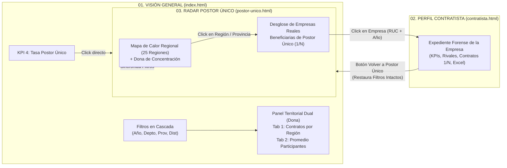

# User Story & Ficha Técnica: Analítica Regional por Empresas (Pantalla 1) y Radar Forense de Postores Únicos por Región con Trazabilidad de Empresas (Pantalla 3)

| Metadato | Detalle Técnico |
| :--- | :--- |
| **ID de Historia** | `US-CONTRATACIONES-003` |
| **Código de Documento** | `ARCH-POSTOR-UNICO-003` |
| **Épica** | OECE / RONIN.SEACE — Cockpit Forense de Contrataciones Públicas del Perú (Enfoque 100% Empresas Reales) |
| **Módulos Afectados** | 1. **Pantalla 1 (`index.html` / Cockpit General):** Reemplazo de *Top Entidades* por Panel Dual con Tabs y Dona Geográfica Dinámica.<br/>2. **Pantalla 3 (`postor-unico.html` / Radar de Postor Único):** Mapa de Calor Regional + Dona, Drill-down de Empresas Beneficiarias de Postor Único y Salto a Pantalla 2.<br/>3. **Navegación Global (`Suite Forense`):** Persistencia transversal de filtros entre las 3 pantallas. |
| **Prioridad** | Alta (P1) |
| **Motor de Base de Datos** | MySQL 8.0+ en WSL (`contrataciones` normalizada en 3FN + `puente_actor_empresa` con prorrateo $1/N$) |
| **Stack Tecnológico** | NestJS (`mysql2/promise`) + Vanilla ES Modules / Tailwind CSS / SVG Data Visualization |
| **Estado** | **Especificación Lista para Implementación (Ready for Dev)** |

---

## 0. Principios Rectores de la Nueva Iteración

> [!IMPORTANT]
> 1. **Enfoque 100% Centrado en Empresas Reales (`puente_actor_empresa`):**
>    - Toda métrica de participantes, ganadores y postores únicos se evalúa sobre **empresas reales (RUC de 11 dígitos)** aplicando la tabla puente `puente_actor_empresa` y el prorrateo equitativo ($1/N$) en consorcios. Jamás se listan consorcios ficticios ni se centra el análisis en entidades compradoras cuando el objetivo es auditar a los proveedores adjudicados.
> 2. **Granularidad Geográfica Adaptativa (Drill-Down Automático en Dona):**
>    - Cuando el usuario filtra por **Departamento** en el Cockpit, agrupar por `departamento_item` produciría una dona de un solo color al 100%.
>    - Por ello, la agrupación geográfica de la dona escala automáticamente según la cascada de filtros activa:
>      - Sin filtro de Departamento (`all`) $\rightarrow$ Agrupa por **Departamento / Región** (`departamento_item`).
>      - Con Departamento seleccionado (` provincia = all`) $\rightarrow$ Agrupa por **Provincia** (`provincia_item`).
>      - Con Provincia seleccionada (`distrito = all` o específico) $\rightarrow$ Agrupa por **Distrito** (`distrito_item`).
> 3. **Persistencia Inquebrantable de Filtros entre las 3 Pantallas:**
>    - Los filtros seleccionados (`year`, `month`, `departamento`, `provincia`, `distrito`, `tipo_proceso`, `estado`, `selectedRegion`, `ruc`) se sincronizan en un estado transversal (`sessionStorage` + Query Params URL) para que al saltar de la **Pantalla 3 $\rightarrow$ Pantalla 2 (Perfil Empresa)** y regresar a la **Pantalla 3**, el auditor encuentre exactamente los mismos filtros y la región activa donde estaba trabajando.

---

## 1. Narrativa Ágil (User Story Narrative)

> **COMO** Auditor Forense y Analista de Competencia del Estado Peruano,  
> **QUIERO** analizar en la pantalla principal la densidad de contratos y el promedio de empresas participantes por región mediante gráficas de dona sensibles a los filtros geográficos, y contar con una **Tercera Pantalla especializada en Postor Único por Región** que me permita seleccionar una región en un Mapa de Calor / Dona, descubrir qué empresas reales ganan sistemáticamente sin competencia en dicho territorio y saltar con un clic a su expediente individual en la Segunda Pantalla conservando mis filtros al regresar,  
> **PARA** detectar monopolios regionales, fraccionamientos geográficos y direccionamiento de licitaciones hacia empresas específicas.



---

## 2. Requerimiento 1: Reemplazo en Pantalla Principal (`index.html`) — Panel Regional con 2 Tabs y Gráfica de Dona

### 2.1. Descripción Funcional
En la columna derecha de `index.html`, se elimina el bloque **"Top Entidades con Mayor Presupuesto Formalizado"** y se reemplaza por el panel **"DINÁMICA TERRITORIAL DE COMPETENCIA Y CONTRATOS"**, compuesto por:

1. **Selector de 2 Pestañas (Tabs Interactivos):**
   - **Tab 1 — `Contratos por Región`:** Muestra una **Gráfica de Dona SVG** + lista lateral con la distribución de contratos formalizados (`total_contratos`, `% sobre el total` y `monto_total_soles`) por región.
   - **Tab 2 — `Promedio de Participantes por Región`:** Muestra una **Gráfica de Dona SVG** + lista lateral con el **promedio de empresas postoras por ítem licitado** (`promedio_participantes = ROUND(AVG(postores_por_item), 2)`) en cada región, permitiendo identificar qué regiones tienen mayor o menor concurrencia competitiva.
2. **Sensibilidad a todos los Filtros del Cockpit:**
   - Responde en tiempo real a `year`, `month`, `departamento`, `provincia`, `distrito`, `tipo_proceso` y `estado`.
   - Aplica la **Granularidad Geográfica Adaptativa**:
     - Nivel Nacional $\rightarrow$ Rebanadas por **Departamento**.
     - Departamento filtrado $\rightarrow$ Rebanadas por **Provincia**.
     - Provincia filtrada $\rightarrow$ Rebanadas por **Distrito**.

### 2.2. Consulta SQL Unificada para el Panel Regional (Cockpit)

```sql
-- Parámetro dinámico de columna geográfica según el filtro activo en Backend:
-- Si departamento IS NULL -> conv.departamento_item
-- Si departamento IS NOT NULL AND provincia IS NULL -> conv.provincia_item
-- Si provincia IS NOT NULL -> conv.distrito_item

WITH contratos_region AS (
    SELECT 
        COALESCE(NULLIF(TRIM(${geoColumn}), ''), 'NO ESPECIFICADO') AS region,
        c.codigo_contrato,
        c.numero_item,
        c.codigo_convocatoria,
        c.monto_contratado_item
    FROM contratos c
    INNER JOIN convocatorias conv 
        ON c.codigo_convocatoria = conv.codigo_convocatoria 
       AND c.numero_item = conv.numero_item
    WHERE YEAR(c.fecha_suscripcion_contrato) = ?
      AND (? IS NULL OR MONTH(c.fecha_suscripcion_contrato) = ?)
      AND (? IS NULL OR conv.departamento_item = ?)
      AND (? IS NULL OR conv.provincia_item = ?)
      AND (? IS NULL OR conv.distrito_item = ?)
      AND (? IS NULL OR conv.moneda = ?)
      AND (? IS NULL OR conv.tipo_proceso_seleccion = ?)
      AND (? IS NULL OR conv.estado_item = ?)
),
postores_por_item_region AS (
    SELECT 
        cr.region,
        cr.codigo_convocatoria,
        cr.numero_item,
        COUNT(DISTINCT o.id_postor) AS cant_postores
    FROM (
        SELECT DISTINCT region, codigo_convocatoria, numero_item 
        FROM contratos_region
    ) cr
    LEFT JOIN ofertantes o 
        ON cr.codigo_convocatoria = o.codigo_convocatoria 
       AND cr.numero_item = o.numero_item
    GROUP BY cr.region, cr.codigo_convocatoria, cr.numero_item
),
metricas_participantes AS (
    SELECT 
        region,
        ROUND(COALESCE(AVG(NULLIF(cant_postores, 0)), 1.00), 2) AS promedio_participantes,
        SUM(CASE WHEN cant_postores = 1 THEN 1 ELSE 0 END) AS items_postor_unico
    FROM postores_por_item_region
    GROUP BY region
),
metricas_contratos AS (
    SELECT 
        region,
        COUNT(DISTINCT codigo_contrato, numero_item) AS total_contratos,
        COALESCE(SUM(monto_contratado_item), 0.00) AS monto_total_soles
    FROM contratos_region
    GROUP BY region
)
SELECT 
    mc.region,
    mc.total_contratos,
    mc.monto_total_soles,
    ROUND(
        (mc.total_contratos * 100.0) / NULLIF(SUM(mc.total_contratos) OVER(), 0), 
        2
    ) AS porcentaje_contratos,
    COALESCE(mp.promedio_participantes, 1.00) AS promedio_participantes,
    COALESCE(mp.items_postor_unico, 0) AS items_postor_unico
FROM metricas_contratos mc
LEFT JOIN metricas_participantes mp ON mc.region = mp.region
ORDER BY mc.total_contratos DESC, mc.monto_total_soles DESC;
```

---

## 3. Requerimiento 2: Tercera Pantalla (`postor-unico.html`) — Informe Forense de Postores Únicos por Región y Desglose de Empresas

### 3.1. Recomendación de Diseño Visual: ¿Dona o Mapa de Calor?

> [!TIP]
> **Recomendación de Arquitectura Visual: Vista Combinada (Matriz de Calor Regional Interactiva + Dona de Concentración Top 6)**
> - **Por qué NO usar solo una Dona para 25 regiones:** El Perú tiene 24 departamentos + Callao. En una gráfica de dona, a partir de la 7.ª región las tajadas miden menos de $2^\circ$, volviéndose imposibles de cliquear con precisión.
> - **Por qué el Mapa de Calor Regional (Treemap / Bento Heatmap Grid) + Dona Lateral es superior:**
>   1. **Mapa de Calor Regional (Panel Izquierdo — 7 columnas):** Presenta las regiones/provincias como celdas interactivas coloreadas por su **Nivel de Riesgo de Postor Único** (`% de contratos adjudicados a postor único` y `cantidad de contratos sin competencia`):
>      - 🔴 **Riesgo Crítico ($\ge 40\%$):** Bermellón Intenso (`#9E1B1E`).
>      - 🟡 **Riesgo Moderado ($25\% \text{ – } 39.9\%$):** Dorado Ámbar (`#C5A059`).
>      - ⚫ **Riesgo Controlado ($< 25\%$):** Piedra Sumi (`#3D3642`).
>      Cada celda es un botón grande y fácil de pulsar que muestra: **Nombre de la Región**, **N° de Contratos con Postor Único**, **Tasa %** y **Monto S/ en Postor Único**.
>   2. **Dona de Concentración Territorial (Panel Derecho Superior — 5 columnas):** Resume visualmente qué porcentaje del total nacional de contratos con postor único acaparan las Top 6 regiones más críticas vs. el resto del país. Ambos componentes están sincronizados: hacer clic en una tajada de la dona o en una celda del mapa de calor selecciona la región.

### 3.2. Flujo de Interacción Paso a Paso (Drill-Down Regional $\rightarrow$ Empresas $\rightarrow$ Perfil)

1. **Paso 1 — Vista Macro Regional (con Filtros Persistentes):**
   - La barra superior incluye los filtros de `Ejercicio Fiscal (2022–2026 o Todos)`, `Departamento`, `Provincia`, `Modalidad` y `Objeto Contractual`.
   - Muestra 4 KPIs específicos de Postor Único:
     1. `Total Contratos con Postor Único`
     2. `Monto Adjudicado sin Competencia (S/)`
     3. `Empresas Beneficiarias de Postor Único` (Empresas reales únicas vía `puente_actor_empresa`)
     4. `Región con Mayor Concentración`
2. **Paso 2 — Click en una Región (Desglose de Empresas que fueron Postor Único):**
   - Al hacer clic sobre una región en el **Mapa de Calor** o en la **Dona** (ej. `LIMA`, `CUSCO`, `PIURA`, o una provincia si ya filtró por departamento), se despliega/actualiza la grilla inferior: **"EMPRESAS ADJUDICADAS COMO POSTOR ÚNICO EN [REGIÓN SELECCIONADA]"**.
   - Cada fila de esta tabla es una **Empresa Real** (`emp.numero_documento`, `emp.razon_social`) y muestra:
     - **RUC y Razón Social de la Empresa**.
     - **Contratos como Postor Único en la Región** (ej. `14 contratos`).
     - **Total Contratos en la Región** (ej. `16 contratos` $\rightarrow$ barra visual indicando que el `87.5%` de lo que gana en esa región es sin competencia).
     - **Modalidad Predominante:** cuántos los ganó de forma `INDIVIDUAL` y cuántos `EN CONSORCIO (1/N)`.
     - **Monto Adjudicado en Postor Único ($1/N$ en S/):** suma exacta atribuida a la empresa (`ROUND(c.monto_contratado_item * pae.factor_equitativo, 2)`).
     - **Entidades Compradoras Principales en esa Región:** cantidad de entidades donde fue postor único.
     - **Botón de Acción:** `Auditar Empresa ↗`.
3. **Paso 3 — Selección de Empresa y Salto a la Segunda Página (`contratista.html`):**
   - Al hacer clic en cualquier empresa de la tabla, el sistema guarda el estado actual de la Pantalla 3 en `sessionStorage` y redirige a:
     `/contratista.html?ruc=20546959181&year=2024&from=postor-unico`
   - En `contratista.html`, si detecta `from=postor-unico` (o al pulsar la pestaña `03. EXPLORADOR POSTOR ÚNICO` en la cabecera), muestra un botón contextual **"← Volver al Radar de Postor Único (Región: CUSCO)"** que regresa a `/postor-unico.html` restaurando todos los filtros y la región activa.

---

## 4. Consultas SQL para la Tercera Pantalla (`postor-unico`)

### 4.1. Query 1: Mapa de Calor y Dona de Postor Único por Región (`GET /api/v1/postor-unico/regiones`)

```sql
WITH items_un_postor AS (
    SELECT 
        o.codigo_convocatoria,
        o.numero_item
    FROM ofertantes o
    GROUP BY o.codigo_convocatoria, o.numero_item
    HAVING COUNT(DISTINCT o.id_postor) = 1
),
contratos_evaluados AS (
    SELECT 
        COALESCE(NULLIF(TRIM(${geoColumn}), ''), 'NO ESPECIFICADO') AS region,
        c.codigo_contrato,
        c.numero_item,
        c.id_contratista,
        c.monto_contratado_item,
        CASE WHEN iup.codigo_convocatoria IS NOT NULL THEN 1 ELSE 0 END AS es_postor_unico
    FROM contratos c
    INNER JOIN convocatorias conv 
        ON c.codigo_convocatoria = conv.codigo_convocatoria 
       AND c.numero_item = conv.numero_item
    LEFT JOIN items_un_postor iup 
        ON c.codigo_convocatoria = iup.codigo_convocatoria 
       AND c.numero_item = iup.numero_item
    WHERE (? IS NULL OR YEAR(c.fecha_suscripcion_contrato) = ?)
      AND (? IS NULL OR MONTH(c.fecha_suscripcion_contrato) = ?)
      AND (? IS NULL OR conv.departamento_item = ?)
      AND (? IS NULL OR conv.provincia_item = ?)
      AND (? IS NULL OR conv.distrito_item = ?)
      AND (? IS NULL OR conv.tipo_proceso_seleccion = ?)
)
SELECT 
    ce.region,
    COUNT(DISTINCT ce.codigo_contrato, ce.numero_item) AS total_contratos_region,
    COUNT(DISTINCT CASE WHEN ce.es_postor_unico = 1 THEN CONCAT(ce.codigo_contrato, '-', ce.numero_item) END) AS contratos_postor_unico,
    ROUND(
        COALESCE(
            (COUNT(DISTINCT CASE WHEN ce.es_postor_unico = 1 THEN CONCAT(ce.codigo_contrato, '-', ce.numero_item) END) * 100.0) /
            NULLIF(COUNT(DISTINCT ce.codigo_contrato, ce.numero_item), 0),
            0.00
        ), 2
    ) AS tasa_postor_unico_region_pct,
    COALESCE(SUM(CASE WHEN ce.es_postor_unico = 1 THEN ce.monto_contratado_item ELSE 0 END), 0.00) AS monto_postor_unico_soles,
    ROUND(
        (COUNT(DISTINCT CASE WHEN ce.es_postor_unico = 1 THEN CONCAT(ce.codigo_contrato, '-', ce.numero_item) END) * 100.0) /
        NULLIF(SUM(COUNT(DISTINCT CASE WHEN ce.es_postor_unico = 1 THEN CONCAT(ce.codigo_contrato, '-', ce.numero_item) END)) OVER(), 0),
        2
    ) AS pct_sobre_total_nacional_pu
FROM contratos_evaluados ce
GROUP BY ce.region
HAVING contratos_postor_unico > 0
ORDER BY contratos_postor_unico DESC, monto_postor_unico_soles DESC;
```

### 4.2. Query 2: Desglose de Empresas Reales Beneficiarias de Postor Único en una Región (`GET /api/v1/postor-unico/empresas`)

```sql
WITH items_un_postor AS (
    SELECT 
        o.codigo_convocatoria,
        o.numero_item
    FROM ofertantes o
    GROUP BY o.codigo_convocatoria, o.numero_item
    HAVING COUNT(DISTINCT o.id_postor) = 1
),
contratos_region_empresa AS (
    SELECT 
        emp.id_organizacion,
        emp.numero_documento AS ruc,
        emp.razon_social,
        c.codigo_contrato,
        c.numero_item,
        conv.ruc_entidad,
        pae.es_consorcio,
        ROUND(c.monto_contratado_item * pae.factor_equitativo, 2) AS monto_atribuido,
        CASE WHEN iup.codigo_convocatoria IS NOT NULL THEN 1 ELSE 0 END AS es_postor_unico
    FROM contratos c
    INNER JOIN puente_actor_empresa pae 
        ON c.id_contratista = pae.id_actor_original
    INNER JOIN organizaciones emp 
        ON pae.id_empresa_real = emp.id_organizacion
    INNER JOIN convocatorias conv 
        ON c.codigo_convocatoria = conv.codigo_convocatoria 
       AND c.numero_item = conv.numero_item
    LEFT JOIN items_un_postor iup 
        ON c.codigo_convocatoria = iup.codigo_convocatoria 
       AND c.numero_item = iup.numero_item
    WHERE (? IS NULL OR YEAR(c.fecha_suscripcion_contrato) = ?)
      AND (? IS NULL OR MONTH(c.fecha_suscripcion_contrato) = ?)
      AND COALESCE(NULLIF(TRIM(${geoColumn}), ''), 'NO ESPECIFICADO') = ?
      AND (? IS NULL OR conv.departamento_item = ?)
      AND (? IS NULL OR conv.provincia_item = ?)
      AND (? IS NULL OR conv.distrito_item = ?)
      AND (? IS NULL OR conv.tipo_proceso_seleccion = ?)
)
SELECT 
    ruc,
    razon_social,
    COUNT(DISTINCT CASE WHEN es_postor_unico = 1 THEN CONCAT(codigo_contrato, '-', numero_item) END) AS contratos_postor_unico,
    COUNT(DISTINCT codigo_contrato, numero_item) AS total_contratos_region,
    ROUND(
        (COUNT(DISTINCT CASE WHEN es_postor_unico = 1 THEN CONCAT(codigo_contrato, '-', numero_item) END) * 100.0) /
        NULLIF(COUNT(DISTINCT codigo_contrato, numero_item), 0),
        1
    ) AS pct_dominancia_pu,
    SUM(CASE WHEN es_postor_unico = 1 AND es_consorcio = 0 THEN 1 ELSE 0 END) AS pu_individuales,
    SUM(CASE WHEN es_postor_unico = 1 AND es_consorcio = 1 THEN 1 ELSE 0 END) AS pu_en_consorcio,
    COALESCE(SUM(CASE WHEN es_postor_unico = 1 THEN monto_atribuido ELSE 0 END), 0.00) AS monto_postor_unico_soles,
    COUNT(DISTINCT CASE WHEN es_postor_unico = 1 THEN ruc_entidad END) AS entidades_capturadas
FROM contratos_region_empresa
GROUP BY id_organizacion, ruc, razon_social
HAVING contratos_postor_unico > 0
ORDER BY contratos_postor_unico DESC, monto_postor_unico_soles DESC
LIMIT ? OFFSET ?;
```

---

## 5. Arquitectura de Persistencia Transversal de Filtros (`FilterStateManager`)

Para garantizar que al cambiar entre la **Pantalla 1 (`index.html`)**, la **Pantalla 2 (`contratista.html`)** y la **Pantalla 3 (`postor-unico.html`)** los filtros prevalezcan intactos:

| Clave en `sessionStorage` | Contenido Persistido | Comportamiento al Navegar |
| :--- | :--- | :--- |
| `ronin_global_filters` | `{ year, month, departamento, provincia, distrito, tipo_proceso, estado }` | Sincronizado entre P1 y P3; P2 hereda `year`. |
| `ronin_postor_unico_state` | `{ ...globalFilters, selectedRegion, geoLevel, page, sortBy }` | Al volver desde P2 (`contratista.html`) hacia P3 (`postor-unico.html`), restaura los selectores, re-selecciona la región activa en el mapa de calor/dona y recarga la tabla de empresas en la misma página. |
| `ronin_last_company` | `{ ruc, razon_social }` | Permite pasar de P3 $\rightarrow$ P2 o P1 $\rightarrow$ P2 manteniendo la empresa auditada activa. |

---

## 6. Criterios de Aceptación (Gherkin)

### Escenario 1: Tabs Regionales con Dona Dinámica en Pantalla Principal
* **DADO QUE** el usuario se encuentra en `index.html`,
* **CUANDO** visualiza el tercer panel gráfico y alterna entre los tabs **"Cantidad de Contratos por Región"** y **"Promedio de Participantes por Región"**,
* **ENTONCES** se renderiza una gráfica de dona interactiva junto con el desglose porcentual/numérico,
* **Y** si el usuario filtra por un Departamento (ej. `AREQUIPA`), la dona cambia automáticamente su agrupación para mostrar las **Provincias** de Arequipa (y si filtra por Provincia, muestra sus **Distritos**).

### Escenario 2: Exploración Regional de Postor Único en Pantalla 3
* **DADO QUE** el usuario ingresa a `03. EXPLORADOR POSTOR ÚNICO` (`/postor-unico.html`),
* **CUANDO** selecciona un año o filtro y hace clic en una región dentro del **Mapa de Calor Regional** o de la **Gráfica de Dona**,
* **ENTONCES** el panel de detalle carga todas las **empresas reales** que obtuvieron contratos como postor único en dicha región (incluyendo adjudicaciones individuales y en consorcio prorrateadas $1/N$).

### Escenario 3: Salto a Perfil de Contratista y Retorno con Filtros Intactos
* **DADO QUE** el usuario examina el desglose de empresas con postor único de una región en la Pantalla 3,
* **CUANDO** hace clic en una empresa de la lista,
* **ENTONCES** el navegador abre la Pantalla 2 (`/contratista.html?ruc=...&year=...&from=postor-unico`) cargando el expediente completo de esa empresa,
* **Y CUANDO** el usuario regresa a la Pantalla 3 (mediante el botón de retorno o la barra superior),
* **ENTONCES** la Pantalla 3 conserva exactamente el año, departamento, provincia y región seleccionada que tenía antes de salir.

